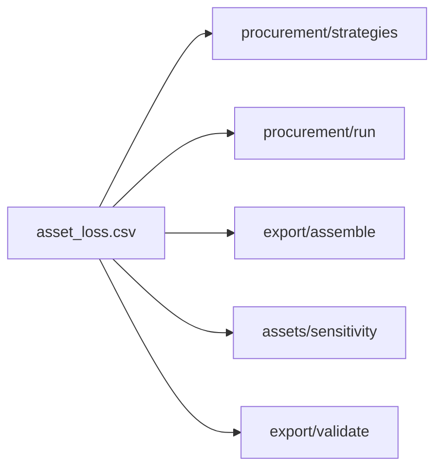

# Архитектурное ревью `src/floodvalue` — 26.09.2026

Разбор модулей, которые чаще всего менялись за 23–26.09. Состояние кода — `main` `e1ee6b8`.

Коммитов на файл за этот период:
- `procurement/run.py` — 15;
- `export/assemble.py` — 15;
- `procurement/strategies.py` — 14;
- `export/run.py` — 12;
- `export/validate.py`, `assets/run.py`, `app/run.py` — по 10.

Цель — найти места, где одна и та же логика разнесена по нескольким модулям и эти копии расходятся. Каждое такое расхождение уже приходилось чинить отдельным фиксом.

Модули `data`, `model` и `calibration` не рассматривались: к `eval-test` они замораживаются, после него их правки запрещены.

Код не менялся. По каждому кандидату заведена issue. Брать их — по обычным правилам (`CLAUDE.md`, `GIT.md`) и с учётом раздела «Правила для тех, кто возьмёт».

## Словарь

| Термин | Смысл |
|---|---|
| **Модуль** | Всё, у чего есть интерфейс и реализация: функция, файл, пакет. |
| **Интерфейс** | Всё, что нужно знать вызывающему: параметры, инварианты, ошибки, конфиги. |
| **Глубокий модуль** | Много поведения за маленьким интерфейсом. У **мелкого** интерфейс почти так же сложен, как реализация. |
| **Шов** | Место, где поведение можно подменить, не правя код в этом месте. Здесь проходит интерфейс модуля. |
| **Локальность** | Правка, баг и тест сосредоточены в одном месте. |
| **Рычаг** | Одна реализация окупается во многих местах вызова и тестах. |
| **Тест удаления** | Представить, что модуль удалён. Если его логика расползается по N вызывающим, модуль нужен. Если она просто исчезает, это была лишняя прослойка. |

## Кандидаты

| # | Issue | Что углубить | Оценка | Размер, риск | Когда |
|---|---|---|---|---|---|
| 1 | [#232](https://github.com/Chichetin/kosmo-moskva_umstvenno_ustalye_34/issues/232) | Модуль копеечной арифметики EL и R в `contracts` | сильный | ~60 строк, 5 файлов; низкий | после сдачи |
| 2 | [#233](https://github.com/Chichetin/kosmo-moskva_umstvenno_ustalye_34/issues/233) | `PlanContext` для плана закупки и чувствительности | сильный | ~150 строк; средний | после сдачи |
| 3 | [#234](https://github.com/Chichetin/kosmo-moskva_umstvenno_ustalye_34/issues/234) | EL сценариев чувствительности считает assets, export не повторяет D-028 | сильный | −40 / +10 строк; низкий–средний | после сдачи |
| 4 | [#235](https://github.com/Chichetin/kosmo-moskva_umstvenno_ustalye_34/issues/235) | Одна запись и одно чтение CSV контракта (`contracts.io`) | стоит изучить | ~−70 строк, 6 файлов; низкий | после сдачи |
| 5 | [#236](https://github.com/Chichetin/kosmo-moskva_umstvenno_ustalye_34/issues/236) | Тест паритета: план на ползунке совпадает с файлами комплекта | стоит изучить | тест ~20 строк; низкий | **тест — до 22:00** |
| 6 | [#237](https://github.com/Chichetin/kosmo-moskva_umstvenno_ustalye_34/issues/237) | `paths.s1_file` / `stage_dir`, манифест через схему | спорно | ~80 строк, 7 файлов | после сдачи |
| 7 | [#238](https://github.com/Chichetin/kosmo-moskva_umstvenno_ustalye_34/issues/238) | media: SQL из обработчиков в `store` | спорно | ~100 строк; вне цепочки жюри | после сдачи |

Почему почти всё «после сдачи»:
- рефакторинг сам баллов не приносит;
- каждая правка кода, который пишет 12 файлов, рискует критерием 12 перед стоп-кодом;
- после `eval-test` любая правка `src/` требует повтора по D-030.

Исключение — тест из #236: он не меняет `src/`, а только проверяет критерии 16 и 19.

## 1. Модуль копеечной арифметики — [#232](https://github.com/Chichetin/kosmo-moskva_umstvenno_ustalye_34/issues/232)

**Проблема.** Пять модулей по-своему повторяют одни и те же расчёты:
- сумму EL до копейки;
- фильтр `status == ok`;
- долю охвата;
- R = V·q·min(p, 1−p) (D-049).

Где копии: `procurement/strategies.py:93,106`, `export/validate.py:335`, `assets/sensitivity.py:85`, `procurement/run.py:204,328`, `export/assemble.py:145,159`.

После того как #146 ввёл EL в копейках, их расхождение чинили два фикса подряд: 13f827d и 26d9440 (#173).

**Решение.** Чистые функции в `contracts`, рядом с `product_half_up`: `ok_assets`, `kopeck_sum`, `decision_risk_from_el`, `share`. По D-005 `contracts` можно импортировать всем пяти модулям.

**Выгода.** Контрольная арифметика критериев 13 и 16 живёт в одном месте и проверяется одним тестом.

**Риск.** Если validate возьмёт R из того же модуля, что и procurement, валидатор перестанет проверять производителя независимо. Контрольные числа в тестах validate должны остаться литералами, а не вызовом общей функции.

## 2. Контекст плана закупки — [#233](https://github.com/Chichetin/kosmo-moskva_umstvenno_ustalye_34/issues/233)

**Проблема.** Модуль мелкий:
- у `sensitivity()` 14 параметров;
- `compute_plan` (10 параметров) вызывается в `src/` 8 раз;
- охват и допуск зон строятся тремя способами: `run._context`, `strategies.coverage_at` (фикс контура исключённых зон — 146f3f4) и тестовый `ctx()`;
- тест паритета `tests/procurement/test_plan.py:288` существует только из-за этого дублирования;
- `zones.covered_assets` (`procurement/zones.py:418`) вызывается только из теста.

**Решение.** Неизменяемый `PlanContext` собирается один раз, план и чувствительность считаются по нему.

**Выгода.** Интерфейс сужается до трёх параметров, охват вычисляется в одном месте. Тест паритета и мёртвая функция удаляются.

**Риск.** Средний. Файлы закупки должны остаться побайтно теми же — сверить diff.

## 3. Правила D-028 только в assets — [#234](https://github.com/Chichetin/kosmo-moskva_umstvenno_ustalye_34/issues/234)

**Проблема.**
- export разбирает `changed_inputs_json` и заново применяет правила обрезки из assets (`export/assemble.py:113–135`, `PARAM_CLIP`).
- Если пересчитанная ΣEL не совпала с итогом assets, строка плана C (`…__C_fixed`) не попадает в `sensitivity.csv`. Остаётся лишь запись в `warnings`, а сама строка assets остаётся.
- export читает колонку procurement `covered_asset_ids`, которой нет среди полей `strategy_comparison.csv`.

**Решение.** assets пишет EL по объектам для каждого сценария — это дополнительный ключ, §7a его допускает. export только суммирует.

**Выгода.** Правила D-028 живут в одном модуле. Проверка расхождения больше не нужна, строки не теряются.

**Риск.** Низкий–средний. `changed_inputs_json` в `sensitivity.csv` меняется по замыслу — приложить ожидаемый diff.

## 4. Одна запись и одно чтение CSV — [#235](https://github.com/Chichetin/kosmo-moskva_umstvenno_ustalye_34/issues/235)

**Проблема.**
- Три производителя по-разному записывают ячейки. В procurement `repr(float)` запишет NaN как `nan`, и validate отклонит файл — это латентный дефект.
- Нестрогий `_read_csv` скопирован трижды.
- Списки полей объявлены повторно.
- В `REQUIRED` в `app/run.py` 10 обязательных файлов из 12.

**Решение.** `contracts.io.write_csv` с одной политикой ячейки: пусто, а не ноль. Во всех модулях — строгие читатели, поля — из `contracts/files.py`.

**Выгода.** Правило «пусто вместо NaN/Inf» живёт в одном месте, интерфейс не принимает неполный комплект.

**Риск.** Низкий. Может измениться форматирование float — сверить по эталону `tests/fixtures/good`.

## 5. Ползунок совпадает с файлами комплекта — [#236](https://github.com/Chichetin/kosmo-moskva_umstvenno_ustalye_34/issues/236)

**Проблема.** `/api/plan` пересчитывает план по **текущим** `configs/`, а не по ценам из `run_metadata.json` комплекта. Совпадение ползунка со `strategy_plans.json` и `strategy_comparison.csv` комплекта не тестируется.

**Решение.** Сначала тест паритета (~20 строк). Потом — предупреждение, если хеш конфигурации не совпал.

**Выгода.** Критерии 16 и 19: ползунок и сданные файлы не расходятся незаметно.

**Риск.** Низкий: сначала только тест.

## 6. Пути в `paths` — [#237](https://github.com/Chichetin/kosmo-moskva_umstvenno_ustalye_34/issues/237)

**Проблема.**
- Путь к S1Hand собирается в 8 местах. Два из них заморожены и не переводятся: `data/split.py` и `model/predict.py:47`.
- `source_manifest_s1.json` в 5 местах разбирают вручную, хотя схема `SourceManifest` уже есть.
- Для каталога результатов действуют 5 разных правил.

**Решение.** `paths.s1_file`, `paths.stage_dir`, `contracts.s1_source`.

**Выгода.** Скромная: код в основном переезжает. Тесты app смогут подменять переменные окружения, а не внутренности модуля.

**Риск.** Низкий–средний.

## 7. media: запросы в store — [#238](https://github.com/Chichetin/kosmo-moskva_umstvenno_ustalye_34/issues/238)

**Проблема.** `create_app` в `media/web.py` — замыкание примерно на 450 строк, SQL написан прямо в маршрутах. Проверить запросы можно только через HTTP.

**Решение.** Перенести запросы в `store` и `events`.

**Выгода.** Запросы тестируются на временной SQLite без HTTP.

**Риск.** Низкий. Это вне цепочки, которую проверяет жюри.

## С чего начинать

После сдачи — **#232**:
- маленький и чистый;
- не трогает замороженные модули;
- убирает класс ошибок, который уже дважды пришлось чинить.

#233 и #234 естественно ложатся поверх него. До заморозки в 22:00 — только тест из **#236**.

## Правила для тех, кто возьмёт

- **Заморозка (CLAUDE.md, D-030).** К `eval-test` замораживаются `models/`, `configs/`, `splits/`, `src/floodvalue/{data,model,calibration}`; после `eval-test` их правки запрещены. Любая другая правка `src/` после `eval-test` — это повтор той же конфигурации по D-030 с новой строкой в `docs/verification/test-log.md`. Поэтому #232–#235, #237 и п. 2 из #236 — после сдачи, а не «после `eval-test`, если есть запас».
- **Отдельный PR.** #232, #235 и #237 меняют общие модули `contracts` и `paths`. Нужен отдельный PR, `reviewer` проверяет всех потребителей (`CLAUDE.md`, раздел «Ревью»).
- **Diff до и после.** Любая правка кода, который пишет 12 файлов, — с diff выходных файлов `make all CHIP=Sri-Lanka_713926 BUDGET=5000` до и после. Ожидание — побайтно те же файлы, кроме `run_metadata.json` (`created_at`, `commit`, `run_id`). Для #234 — ожидаемый diff `changed_inputs_json` в `sensitivity.csv`.
- **Номер решения.** `D-…` — следующий за последним в `origin/main`.
