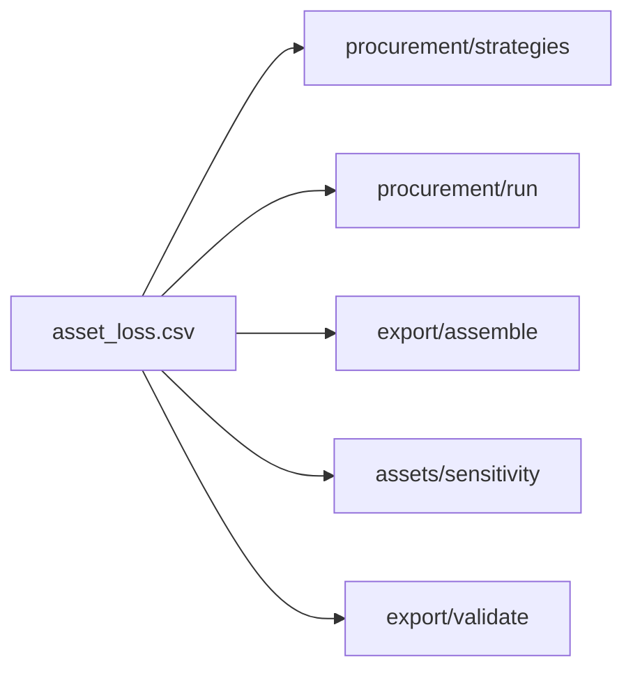

# Архитектурное ревью `src/floodvalue` — 26.09.2026

Разбор модулей, которые чаще всего менялись за 23–26.09. Состояние кода — `main` `86655b6`.

Правки за этот период (число коммитов на файл):
- `procurement/run.py` — 15;
- `export/assemble.py` — 15;
- `procurement/strategies.py` — 14;
- `export/run.py` — 12;
- `export/validate.py`, `assets/run.py`, `app/run.py` — по 10.

Цель ревью — найти места, где одна и та же логика размазана по нескольким модулям и расходится. Каждый такой случай уже стоил фикса. `data`, `model` и `calibration` не рассматривались: они заморожены до `eval-test`.

Код не менялся. По каждому кандидату заведена issue; брать их — по обычным правилам (`CLAUDE.md`, `GIT.md`).

## Словарь

| Термин | Смысл |
|---|---|
| **Модуль** | Всё, у чего есть интерфейс и реализация: функция, файл, пакет. |
| **Интерфейс** | Всё, что вызывающему нужно знать: параметры, инварианты, ошибки, конфиги. |
| **Глубокий модуль** | Много поведения за маленьким интерфейсом. **Мелкий** — интерфейс почти такой же сложный, как реализация. |
| **Шов** | Место, где поведение можно подменить, не правя код в этом месте. Здесь живёт интерфейс модуля. |
| **Локальность** | Правка, баг и тест сосредоточены в одном месте. |
| **Рычаг** | Одна реализация окупается во многих местах вызова и тестах. |
| **Тест удаления** | Представить, что модуль удалён. Если сложность расползается по N вызывающим, модуль нужен. Если просто исчезает, это была прослойка. |

## Кандидаты

| # | Issue | Что углубить | Оценка | Размер, риск | Когда |
|---|---|---|---|---|---|
| 1 | [#232](https://github.com/Chichetin/kosmo-moskva_umstvenno_ustalye_34/issues/232) | Реестр копеечного EL и R в `contracts` | сильный | ~60 строк, 5 файлов; низкий | после сдачи |
| 2 | [#233](https://github.com/Chichetin/kosmo-moskva_umstvenno_ustalye_34/issues/233) | `PlanContext` для плана закупки и чувствительности | сильный | ~150 строк; средний | после сдачи |
| 3 | [#234](https://github.com/Chichetin/kosmo-moskva_umstvenno_ustalye_34/issues/234) | EL сценариев чувствительности пишет assets, export не повторяет D-028 | сильный | −40 / +10 строк; низкий–средний | после сдачи |
| 4 | [#235](https://github.com/Chichetin/kosmo-moskva_umstvenno_ustalye_34/issues/235) | Одна запись и одно чтение CSV контракта (`contracts.io`) | стоит изучить | ~−70 строк, 6 файлов; низкий | после сдачи |
| 5 | [#236](https://github.com/Chichetin/kosmo-moskva_umstvenno_ustalye_34/issues/236) | Тест паритета: план на ползунке = файлы комплекта | стоит изучить | тест ~20 строк; низкий | **тест — до 22:00** |
| 6 | [#237](https://github.com/Chichetin/kosmo-moskva_umstvenno_ustalye_34/issues/237) | `paths.s1_file` / `stage_dir`, манифест через схему | спорно | ~80 строк, 7 файлов | после сдачи |
| 7 | [#238](https://github.com/Chichetin/kosmo-moskva_umstvenno_ustalye_34/issues/238) | media: SQL из обработчиков в `store` | спорно | ~100 строк; вне цепочки жюри | после сдачи |

Почему почти всё «после сдачи»: рефакторинг сам баллов не приносит, а каждая правка файлов комплекта рискует критерием 12 перед стоп-кодом. Исключение — тест из #236: он ничего не меняет в коде, а только сторожит критерии 16 и 19.

## 1. Реестр копеечного EL — [#232](https://github.com/Chichetin/kosmo-moskva_umstvenno_ustalye_34/issues/232)

**Проблема.** Пять модулей повторяют одни и те же расчёты:
- сумму EL до копейки;
- фильтр `status == ok`;
- долю охвата;
- R = V·q·min(p, 1−p) (D-049).

Копии живут в `strategies.py:93,106`, `validate.py:335`, `sensitivity.py:85`, `run.py:204,328`, `assemble.py:145,159`. Три фикса подряд чинили именно расхождение копий: 13f827d, 26d9440, #146.

**Решение.** Чистый модуль в `contracts` рядом с `product_half_up`: `ok_assets`, `kopeck_sum`, `decision_risk_from_el`, `share`. Всем пяти модулям это разрешено по D-005.

**Выгода.** Контрольная арифметика критериев 13 и 16 — в одном месте и под одним тестом.

## 2. Контекст плана закупки — [#233](https://github.com/Chichetin/kosmo-moskva_umstvenno_ustalye_34/issues/233)

**Проблема.** Модуль мелкий:
- у `sensitivity()` 14 параметров, `compute_plan` вызывается 8 раз с 11 аргументами;
- охват и допуск зон строятся тремя способами: `run._context`, `strategies.coverage_at` (баг #147) и тестовый `ctx()`;
- тест паритета `test_plan.py:288` существует только из-за этого дублирования.

**Решение.** Неизменяемый `PlanContext` собирается один раз. План и чувствительность считаются по нему.

**Выгода.** Интерфейс сужается до трёх параметров. Охват вычисляется в одном месте.

**Риск.** Выходные файлы закупки должны остаться побайтно теми же — сверять diff.

## 3. Правила D-028 только в assets — [#234](https://github.com/Chichetin/kosmo-moskva_umstvenno_ustalye_34/issues/234)

**Проблема.** export разбирает `changed_inputs_json` и заново применяет правила обрезки из assets (`assemble.py:113–135`, `PARAM_CLIP`). Если ΣEL разойдётся, строка чувствительности молча выпадает, остаётся только предупреждение. Кроме того, export зависит от колонки procurement `covered_asset_ids`, которой нет в контракте.

**Решение.** assets пишет EL по объектам для каждого сценария (дополнительный ключ, §7a это допускает). export только суммирует.

## 4. Одна запись и одно чтение CSV — [#235](https://github.com/Chichetin/kosmo-moskva_umstvenno_ustalye_34/issues/235)

**Проблема.**
- Три производителя по-разному записывают ячейки. В procurement `repr(float)` запишет NaN как `nan`, и validate отклонит файл — это латентный дефект.
- Нестрогий `_read_csv` скопирован три раза.
- Списки полей объявлены повторно.
- В `app.REQUIRED` 10 из 12 обязательных файлов.

**Решение.** `contracts.io.write_csv` с одной политикой ячейки («пусто, не ноль»). Строгие читатели — во всех модулях, поля — из `contracts/files.py`.

## 5. Ползунок = файлы комплекта — [#236](https://github.com/Chichetin/kosmo-moskva_umstvenno_ustalye_34/issues/236)

**Проблема.** `/api/plan` пересчитывает план по **текущим** `configs/`, а не по ценам из `run_metadata.json` комплекта. Совпадение ползунка со `strategy_comparison.csv` не тестируется.

**Решение.** Сначала тест паритета (~20 строк). Потом — предупреждение, если хеш конфигурации не совпал.

## 6. Пути в `paths` — [#237](https://github.com/Chichetin/kosmo-moskva_umstvenno_ustalye_34/issues/237)

**Проблема.**
- Путь к S1Hand собирается в 8 местах.
- `source_manifest_s1.json` в 5 местах разбирают вручную, хотя схема `SourceManifest` уже есть.
- Для каталога результатов действуют 5 разных правил.

**Решение.** `paths.s1_file`, `paths.stage_dir`, `contracts.s1_source`. Выгода скромная: код в основном переезжает.

## 7. media: запросы в store — [#238](https://github.com/Chichetin/kosmo-moskva_umstvenno_ustalye_34/issues/238)

**Проблема.** `create_app` в `media/web.py` — замыкание примерно на 460 строк, SQL написан прямо в маршрутах. Проверить запросы можно только через HTTP.

**Решение.** Перенести запросы в `store` и `events`. Это вне цепочки, которую проверяет жюри.

## С чего начинать

После сдачи — **#232**. Он маленький и чистый, не трогает замороженные модули и убирает класс ошибок, который уже трижды пришлось чинить. #233 и #234 естественно ложатся поверх него.

До заморозки 22:00 — только тест из **#236**.

## Правила для тех, кто возьмёт

- #232 и #235 меняют `contracts`: отдельный PR, `reviewer` проверяет всех потребителей (`CLAUDE.md`, «Ревью»).
- Любая правка производителей 12 файлов — с diff выходных файлов `make all CHIP=Sri-Lanka_713926 BUDGET=5000` до и после. Ожидание по умолчанию — побайтно те же файлы.
- `src/floodvalue/{data,model,calibration}` до `eval-test` не трогать; после него — только по D-030.
- Номер решения `D-…` — следующий за последним в `origin/main`.
