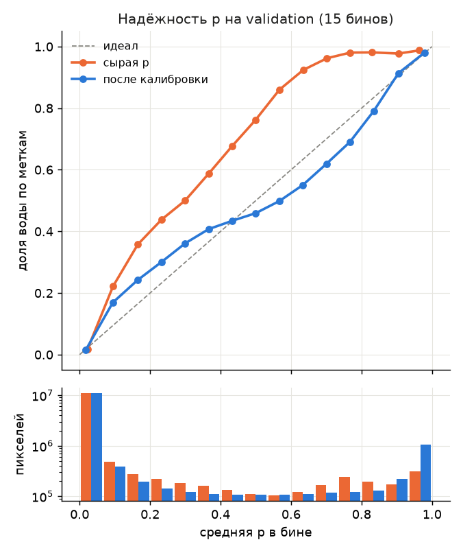
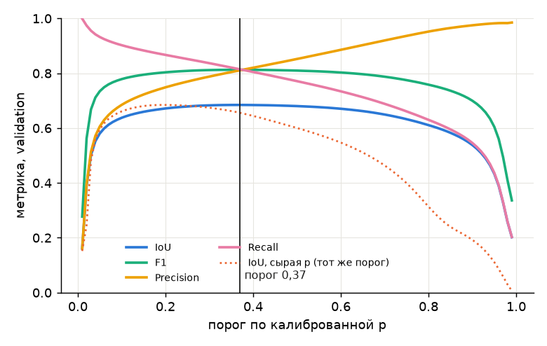
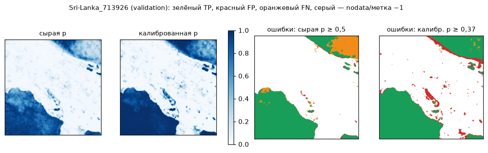

# Калибровка и порог основного метода на validation

Сгенерировано `make calibrate` (`python -m floodvalue calibrate`, `FLOODVALUE_METHOD=unet`), commit `496d22e0ffb8`, 2026-09-25T16:45:00+00:00. Параметры — `models/unet/calibration.json`; таблицы — `docs/verification/calibration/*.csv`.

**Протокол (D-012, D-016, D-029).** Всё подбирается только на validation: Nigeria, Sri-Lanka — 60 чипов, 13 983 779 валидных пикселей, доля воды 15,2 % (в train около 8,9 %). Split `splits/split_v1.json`, sha256 `0098346e0f87…`. **Test не читался**: код берёт только `chip_ids("validation")`, метки test запечатаны в `floodvalue.data.io.load_label`. На validation выбраны две вещи: (1) вид калибратора — по log-loss **вне события** (подгонка на одном событии, проверка на другом); (2) порог — максимум IoU калиброванной p по всей validation. Итоговые числа validation поэтому оптимистичны; честная оценка переноса — таблица «между событиями» ниже и test (#19).

Входная модель: `models/unet/config.json`, `weights_sha256` `504944cd880c…`. Сырая p — `predict_proba` метода (docs/contracts.md §3), посчитана на CPU (fp32).

## Итог: было → стало (validation, одни и те же валидные пиксели)

| Событие | Этап | Порог | IoU | F1 | Precision | Recall | ECE (15 бинов) | Brier | log-loss | средняя p | доля воды |
|---|---|---|---|---|---|---|---|---|---|---|---|
| ALL | было: сырая p ≥ 0,5 | 0,50 | 0,600 | 0,750 | 0,958 | 0,617 | 0,0398 | 0,0477 | 0,1693 | 0,120 | 0,152 |
| ALL | стало: Platt, p ≥ 0,37 | 0,37 | 0,685 | 0,813 | 0,811 | 0,815 | 0,0100 | 0,0406 | 0,1462 | 0,152 | 0,152 |
| Nigeria | было: сырая p ≥ 0,5 | 0,50 | 0,691 | 0,818 | 0,953 | 0,716 | 0,0484 | 0,0561 | 0,1920 | 0,187 | 0,236 |
| Nigeria | стало: Platt, p ≥ 0,37 | 0,37 | 0,778 | 0,875 | 0,908 | 0,844 | 0,0229 | 0,0457 | 0,1620 | 0,220 | 0,236 |
| Sri-Lanka | было: сырая p ≥ 0,5 | 0,50 | 0,526 | 0,690 | 0,963 | 0,537 | 0,0372 | 0,0443 | 0,1601 | 0,093 | 0,118 |
| Sri-Lanka | стало: Platt, p ≥ 0,37 | 0,37 | 0,621 | 0,766 | 0,742 | 0,791 | 0,0119 | 0,0385 | 0,1398 | 0,124 | 0,118 |

Парный бутстрэп по чипам (2000 повторов, seed 20260925, 60 чипов): ΔIoU (стало − было) = **0,084**, 95 % CI [0,021; 0,155]. Интервал не учитывает, что порог выбран на тех же пикселях; см. перенос между событиями.

**Калибратор: Platt** — p = sigmoid(a·logit(p_raw) + b), a = 1,4647, b = 1,5210. Порог **0,37** по калиброванной p (то же, что сырая p ≥ 0,1975; калибратор монотонный, поэтому ранжирование пикселей не меняется, меняется только шкала p и порог). Максимум F1 на той же сетке — при пороге 0,37.

Метрики калиброванного метода по контракту §7 (dev — только отчёт, порог и калибратор выбраны на validation) — `calibration/unet-metrics.csv`; `valid_mask_sha256` совпадает с baseline и сырым U-Net:

| Часть | Событие | IoU | F1 | Precision | Recall | Порог |
|---|---|---|---|---|---|---|
| dev | ALL | 0,467 | 0,636 | 0,504 | 0,863 | 0,37 |
| dev | USA | 0,467 | 0,636 | 0,504 | 0,863 | 0,37 |
| validation | ALL | 0,685 | 0,813 | 0,811 | 0,815 | 0,37 |
| validation | Nigeria | 0,778 | 0,875 | 0,908 | 0,844 | 0,37 |
| validation | Sri-Lanka | 0,621 | 0,766 | 0,742 | 0,791 | 0,37 |

## Контроль переноса на dev (USA): событие с малой долей воды

Dev в подборе калибратора и порога не участвовал (D-012: dev — выбор модели). Здесь он — проверка, что будет на событии с другой долей воды:

| dev (USA) | Порог | IoU | F1 | Precision | Recall | ECE | Brier | log-loss | средняя p | доля воды |
|---|---|---|---|---|---|---|---|---|---|---|
| было: сырая p ≥ 0,5 | 0,50 | 0,584 | 0,738 | 0,745 | 0,731 | 0,0324 | 0,0202 | 0,0914 | 0,078 | 0,046 |
| стало: Platt, p ≥ 0,37 | 0,37 | 0,467 | 0,636 | 0,504 | 0,863 | 0,0510 | 0,0289 | 0,1227 | 0,097 | 0,046 |

**На dev калибровка ухудшает маску** (IoU 0,584 → 0,467; средняя p 0,097 при доле воды 0,046). Калибратор переносит на новое событие априорную долю воды validation (15,2 %): на событии, где воды в разы меньше, p завышается и порог даёт лишние срабатывания; ухудшаются и ECE, и log-loss, а значит и EL = p·V·q на таком событии завышен. Калибровка остаётся на validation по протоколу D-012 (dev — для выбора модели, test запечатан); этот результат на выбор не влиял. Справочно: сводные доли воды test видели на разведке до split (раскрыто в D-016, 15–18 %, `docs/data.md` §5) — ближе к validation, чем к dev. Вывод для оператора: калиброванная p надёжна для паводков с долей воды порядка validation; на событии с малой долей воды p завышена, и это ограничение переноса, а не свойство модели.

## Выбор калибратора: перенос между событиями

Подгонка на одном событии validation, все метрики — на другом. Порог «из подгонки» — максимум IoU на событии подгонки, применённый без изменений ко второму; «оракул» — лучший порог на самом событии проверки (только ориентир).

| Подгонка → проверка | Калибратор | Параметры | ECE | Brier | log-loss | средняя p / доля воды | порог из подгонки | IoU перенос | IoU сырая 0,5 | IoU оракул |
|---|---|---|---|---|---|---|---|---|---|---|
| Nigeria → Sri-Lanka | без калибровки | — | 0,0372 | 0,0443 | 0,1601 | 0,093 / 0,118 | 0,12 | 0,597 | 0,526 | 0,621 |
| Nigeria → Sri-Lanka | temperature scaling | T=1.049 | 0,0408 | 0,0444 | 0,1615 | 0,096 / 0,118 | 0,13 | 0,596 | 0,526 | 0,621 |
| Nigeria → Sri-Lanka | Platt | a=1.401, b=1.819 | 0,0283 | 0,0401 | 0,1470 | 0,144 / 0,118 | 0,26 | 0,593 | 0,526 | 0,621 |
| Nigeria → Sri-Lanka | изотоническая | 409 узлов | 0,0369 | 0,0446 | 0,1547 | 0,147 / 0,118 | 0,45 | 0,595 | 0,526 | 0,621 |
| Sri-Lanka → Nigeria | без калибровки | — | 0,0484 | 0,0561 | 0,1920 | 0,187 / 0,236 | 0,22 | 0,773 | 0,691 | 0,789 |
| Sri-Lanka → Nigeria | temperature scaling | T=0.922 | 0,0518 | 0,0567 | 0,1943 | 0,184 / 0,236 | 0,21 | 0,772 | 0,691 | 0,790 |
| Sri-Lanka → Nigeria | Platt | a=1.512, b=1.445 | 0,0275 | 0,0467 | 0,1656 | 0,215 / 0,236 | 0,39 | 0,773 | 0,691 | 0,790 |
| Sri-Lanka → Nigeria | изотоническая | 410 узлов | 0,0307 | 0,0464 | 0,1662 | 0,215 / 0,236 | 0,38 | 0,773 | 0,691 | 0,789 |

Среднее по двум направлениям (правило выбора — минимум log-loss вне события):

| Калибратор | log-loss | ECE | Brier | IoU перенос |
|---|---|---|---|---|
| без калибровки | 0,1761 | 0,0428 | 0,0502 | 0,685 |
| temperature scaling | 0,1779 | 0,0463 | 0,0505 | 0,684 |
| Platt ← выбран | 0,1563 | 0,0279 | 0,0434 | 0,683 |
| изотоническая | 0,1604 | 0,0338 | 0,0455 | 0,684 |

На всей validation (подгонка и оценка на одних пикселях — для сравнения гибкости, не для выбора):

| Калибратор | Параметры | ECE | Brier | log-loss | средняя p |
|---|---|---|---|---|---|
| без калибровки | — | 0,0398 | 0,0477 | 0,1693 | 0,120 |
| temperature scaling | T=0.961 | 0,0364 | 0,0478 | 0,1691 | 0,117 |
| Platt | a=1.465, b=1.521 | 0,0100 | 0,0406 | 0,1462 | 0,152 |
| изотоническая | 477 узлов | 0,0000 | 0,0398 | 0,1405 | 0,152 |

## Надёжность вероятностей (reliability, вся validation)



| Бин p | пикселей (сырая) | средняя p | доля воды | пикселей (калибр.) | средняя p | доля воды |
|---|---|---|---|---|---|---|
| [0,00; 0,07) | 11 111 927 | 0,022 | 0,017 | 10 941 951 | 0,018 | 0,015 |
| [0,07; 0,13) | 476 857 | 0,095 | 0,222 | 390 922 | 0,094 | 0,169 |
| [0,13; 0,20) | 271 745 | 0,165 | 0,358 | 192 975 | 0,164 | 0,242 |
| [0,20; 0,27) | 218 109 | 0,232 | 0,438 | 141 339 | 0,232 | 0,301 |
| [0,27; 0,33) | 185 177 | 0,299 | 0,500 | 121 782 | 0,300 | 0,361 |
| [0,33; 0,40) | 160 627 | 0,366 | 0,587 | 112 291 | 0,366 | 0,407 |
| [0,40; 0,47) | 135 850 | 0,432 | 0,676 | 108 111 | 0,433 | 0,434 |
| [0,47; 0,53) | 109 470 | 0,499 | 0,762 | 106 937 | 0,500 | 0,459 |
| [0,53; 0,60) | 103 350 | 0,567 | 0,860 | 107 921 | 0,567 | 0,499 |
| [0,60; 0,67) | 122 519 | 0,635 | 0,924 | 111 963 | 0,634 | 0,551 |
| [0,67; 0,73) | 167 254 | 0,702 | 0,962 | 118 840 | 0,700 | 0,619 |
| [0,73; 0,80) | 240 055 | 0,768 | 0,980 | 123 840 | 0,767 | 0,690 |
| [0,80; 0,87) | 195 826 | 0,829 | 0,981 | 131 106 | 0,834 | 0,791 |
| [0,87; 0,93) | 172 910 | 0,904 | 0,977 | 219 426 | 0,905 | 0,914 |
| [0,93; 1,00) | 312 103 | 0,964 | 0,988 | 1 054 375 | 0,979 | 0,980 |

Сырая p систематически **занижена** во всём диапазоне (сеть обучена на ~8,9 % воды). После калибровки средняя p совпадает с долей воды, ECE падает с 0,0398 до 0,0100. Остаётся S-образное отклонение в середине шкалы: наибольшее — в бине [0,60; 0,67), p 0,634 при доле воды 0,551. Бины 0,2–0,8 содержат 7,5 % пикселей, поэтому ECE мал, но p в середине шкалы (это и есть объекты «на границе») надёжна примерно до ±0,1. Изотоническая функция убирает это на своих данных, но хуже переносится на другое событие (таблица выше).

## Влияние порога на метрики



Кривая целиком — `calibration/threshold_curve.csv` (шаг 0,01, калиброванная и сырая p). Выдержка:

| Порог (калибр. p) | IoU | F1 | Precision | Recall |
|---|---|---|---|---|
| 0,10 | 0,638 | 0,779 | 0,685 | 0,903 |
| 0,20 | 0,672 | 0,804 | 0,749 | 0,867 |
| 0,30 | 0,683 | 0,812 | 0,788 | 0,837 |
| **0,37** | 0,685 | 0,813 | 0,811 | 0,815 |
| 0,50 | 0,680 | 0,810 | 0,852 | 0,771 |
| 0,60 | 0,671 | 0,803 | 0,886 | 0,734 |
| 0,70 | 0,650 | 0,788 | 0,920 | 0,689 |
| 0,80 | 0,611 | 0,758 | 0,952 | 0,630 |
| 0,90 | 0,538 | 0,700 | 0,975 | 0,546 |

**Правило порога — максимум IoU** (метрика сравнения методов, критерий 4). При равенстве берётся меньший порог: оператору (D-001) пропущенный затопленный объект дороже лишнего осмотра. Экономика от порога не зависит: EL = p·V·q берёт p из растра, не из маски (task.md); порог влияет только на `flood_mask.tif` и метрики сегментации.

## Постобработка

Постобработка не применяется. Проверено одно простое сглаживание — среднее 3×3 по калиброванной p (NaN не участвуют) с тем же порогом:

| Событие | IoU без постобработки | IoU со средним 3×3 |
|---|---|---|
| ALL | 0,685 | 0,686 |
| Nigeria | 0,778 | 0,779 |
| Sri-Lanka | 0,621 | 0,621 |

Наибольший выигрыш — 0,0015 IoU, на уровне шума; лишний шаг, меняющий p объектов, не принимается.

## Nodata

- Невалидный пиксель — S1 не конечен (NaN) хотя бы в одном канале: сырая p = NaN, калибратор сохраняет NaN (`calibrator.apply`), в растрах — −9999 (`flood_probability.tif`) и 255 (`flood_mask.tif`), docs/contracts.md §2.
- Метка −1 исключена из подгонки калибратора, выбора порога и метрик; на растры не влияет.
- Маска валидности та же, что у U-Net и baseline (S1 конечен и метка ∈ {0, 1}): 13 983 779 пикселей validation, как в `docs/verification/unet-metrics.md`.

## Постоянная вода: IoU внутри и вне JRC (диагностика, не вход модели)

JRCWaterHand (0/1) из набора Sen1Floods11 используется **только здесь, для отчёта**. В модель, калибратор и порог он не входит: слой, вероятно, построен по данным до 2018 года и для событий 2017–2018 содержит информацию после даты события (`docs/data.md` §7).

| Зона | Пикселей | Доля воды по меткам | IoU было | IoU стало | P / R было | P / R стало | средняя калибр. p |
|---|---|---|---|---|---|---|---|
| JRC = 1 | 918 330 | 0,972 | 0,765 | 0,951 | 0,996 / 0,768 | 0,984 / 0,965 | 0,854 |
| JRC = 0 | 13 065 449 | 0,094 | 0,486 | 0,535 | 0,919 / 0,507 | 0,690 / 0,705 | 0,102 |

Внутри JRC-воды метка = 1 у 97,2 % пикселей: `LabelHand` размечает **всю** воду, включая постоянную, и модель её уверенно находит. Отделить временное затопление по данным, доступным на дату события, мы не можем, поэтому продукт — **карта воды**, а не карта временного затопления (D-007). Для оператора это значит: объект у реки или водоёма получает высокую p и тогда, когда вода там постоянная; такие объекты стоит проверять по своему кадастру водных объектов, а не считать затопленными.

## Пример: Sri-Lanka_713926 (validation)



## Ограничения

- Validation — два события (Nigeria 23,6 % воды, Sri-Lanka 11,8 %). Калибратор сдвигает p к доле воды validation (15,2 %); в test доля воды по разведке 15–18 % (`docs/data.md` §5), но на событии с другой долей воды калибровка может снова разойтись. Перенос между событиями validation это показывает: ECE вне события 0,0279 против 0,0100 при подгонке на всей validation.
- Порог выбран на тех же пикселях, где считаются итоговые числа validation; незавышенная оценка — test (`make eval-test`, #19).
- Калибровка не меняет ранжирование пикселей: ROC/PR-кривая модели та же, выигрыш IoU — от порога, выигрыш log-loss/Brier/ECE — от шкалы p.

## Воспроизведение

```bash
set -a; . ./.env; set +a          # FLOODVALUE_DATA_DIR с Sen1Floods11
make calibrate                     # CPU, около 2 минут: калибратор, порог, этот отчёт
make predict CHIP=Sri-Lanka_713926 # flood_probability.tif уже калиброван, mask ⇔ p ≥ порог
```
