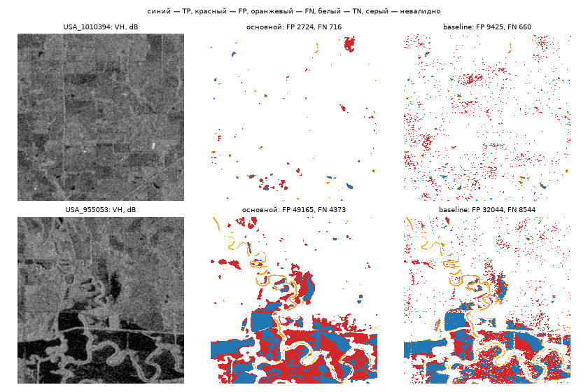

# Итоговая оценка на части `dev`: baseline против основного метода

Сгенерировано `python -m floodvalue eval-test --part dev` (commit `23e3e9215d72`, 2026-09-26), sha256 конфигурации `506ce620d041373c6b312ead25deed6221e79704fe3ce2fa60d24add0ea31c1e`. Числа — из `eval-dev.csv`, `eval-dev-chips.csv`, `eval-dev-reliability.csv`, `eval-dev-proxy.csv`, `eval-dev-summary.json`.

**Это не итоговая независимая проверка.** Часть `dev` использовалась для настройки (D-012/D-016: dev — выбор модели, validation — калибровка и порог), поэтому прогон проверяет проводку отчёта и даёт ориентир, но не оценку переноса. Test не читался (D-010).

- Основной метод: `unet`, порог p ≥ 0.37 (`calibrated (platt) and chosen on validation, D-029`). Растры — те же, что пишет `make predict`.
- Калибровка: применена в predict.
- Baseline: VH ≤ -23.0 dB (`models/baseline/config.json`).
- Чипов: 69; события: USA.
- Валидный пиксель: VV и VH конечны **и** LabelHand ≠ −1. Маска валидности считается отдельно по растру каждого метода и по S1/метке; `valid_mask_sha256` всех трёх совпал по каждому событию и ALL (иначе запуск падает).
- Сверка baseline с `baseline-metrics.csv`: совпадает (TP/FP/FN/TN и valid_mask_sha256).

## 1. Метрики на идентичных валидных пикселях (критерий 4)

| событие | метод | IoU | F1 | Precision | Recall | TP | FP | FN | TN | пикселей |
|---|---|---|---|---|---|---|---|---|---|---|
| USA | baseline | 0,391 | 0,562 | 0,460 | 0,722 | 580921 | 681880 | 223697 | 16152332 | 17638830 |
| USA | основной | 0,467 | 0,636 | 0,504 | 0,863 | 694590 | 684161 | 110028 | 16150051 | 17638830 |
| **ALL** | baseline | 0,391 | 0,562 | 0,460 | 0,722 | 580921 | 681880 | 223697 | 16152332 | 17638830 |
| **ALL** | основной | 0,467 | 0,636 | 0,504 | 0,863 | 694590 | 684161 | 110028 | 16150051 | 17638830 |

Парный бутстрэп по чипам (2000 повторов, seed 20260925; одни и те же выборки чипов для обоих методов), ΔIoU = основной − baseline:

| событие | ΔIoU | 95 % CI | доля Δ > 0 |
|---|---|---|---|
| USA | 0,076 | [0,047; 0,107] | 1,000 |
| ALL | 0,076 | [0,047; 0,107] | 1,000 |

Интервал считается здесь заново (свои выборки чипов), поэтому может отличаться в третьем знаке от других отчётов; для этой части основным считается этот.

## 2. Ложные срабатывания и пропуски по событиям

| событие | метод | FP | FN | FP / (TP+FP) | FN / (TP+FN) |
|---|---|---|---|---|---|
| USA | baseline | 681880 | 223697 | 0,540 | 0,278 |
| USA | основной | 684161 | 110028 | 0,496 | 0,137 |
| ALL | baseline | 681880 | 223697 | 0,540 | 0,278 |
| ALL | основной | 684161 | 110028 | 0,496 | 0,137 |

Карты ошибок (`eval-dev-errors.png`): USA_1010394, USA_955053 — демо-чип части и чип с наибольшим числом ошибок основного метода в каждом событии.



## 3. Надёжность вероятностей основного метода (критерий 9)

10 равных корзин p на [0; 1], по всем валидным пикселям. ECE = Σ n_b/N · |среднее p − доля воды|; Brier = среднее (p − y)².

| событие | ECE | Brier |
|---|---|---|
| USA | 0,051 | 0,029 |
| ALL | 0,051 | 0,029 |

| корзина p | пикселей | среднее p | доля воды |
|---|---|---|---|
| [0,0; 0,1) | 14943161 | 0,023 | 0,005 |
| [0,1; 0,2) | 814236 | 0,141 | 0,022 |
| [0,2; 0,3) | 347687 | 0,245 | 0,040 |
| [0,3; 0,4) | 209704 | 0,347 | 0,063 |
| [0,4; 0,5) | 151121 | 0,448 | 0,096 |
| [0,5; 0,6) | 124260 | 0,549 | 0,140 |
| [0,6; 0,7) | 113926 | 0,650 | 0,209 |
| [0,7; 0,8) | 118264 | 0,751 | 0,309 |
| [0,8; 0,9) | 140682 | 0,852 | 0,439 |
| [0,9; 1,0] | 675789 | 0,980 | 0,794 |

## 4. Неопределённость на ошибках (критерий 10)

Показатель (временный, до #21) — бинарная энтропия p основного метода в битах: нерешительность модели в пикселе, не проверенная неопределённость. Ошибка — маска основного метода ≠ метке. AUROC — вероятность, что у случайного ошибочного пикселя энтропия выше, чем у случайного верного (0,5 — не различает; по гистограмме с шагом 1e-5 бита).

| событие | ошибочных | верных | средняя H на ошибках | на верных | AUROC H → ошибка |
|---|---|---|---|---|---|
| USA | 794189 | 16844641 | 0,702 | 0,196 | 0,864 |
| ALL | 794189 | 16844641 | 0,702 | 0,196 | 0,864 |

## 5. Прокси-проверка ущерба (критерий 14) — прокси, не фактические потери

Правило точек: `python -m floodvalue assets` на растре p основного метода этого чипа — то же правило размещения, что у сдаваемого портфеля (seed 20260925, 10 типов из `configs/assets.yaml`, только валидность S1; прогноз, ущерб и метки не читаются). EL = p·V·q из `asset_loss.csv`; EL_ref = y·V·q, y — ручная метка воды в пикселе точки при тех же учебных V и q. Оцениваются только точки со статусом ok и меткой 0/1.

| выборка | точек поставлено | оценено | исключено: метка −1 | исключено: нет p | MAE, руб. | Σ \|EL − EL_ref\|, руб. | Σ EL, руб. | Σ EL_ref, руб. |
|---|---|---|---|---|---|---|---|---|
| демо-чип `USA_1010394` | 10 | 10 | 0 | 0 | 93 195 | 931 954 | 931 954 | 0 |
| все чипы части, по 10 точек | 690 | 689 | 1 | 0 | 260 945 | 179 790 852 | 273 304 621 | 145 700 000 |

Ошибка — прокси по ручной метке воды, не фактические потери: EL_ref сам зависит от учебных V, q и не наблюдает ущерб. По точкам — `eval-dev-proxy.csv`.

## 6. JRC-диагностика: IoU внутри и вне JRCWaterHand = 1

JRCWaterHand — слой воды набора; вероятно, собран по данным после события, поэтому только диагностика (в метод не подаётся). Внутри JRC = 1 — в основном постоянная вода, вне — то, что ближе к паводку.

| метод | IoU внутри JRC=1 | IoU вне JRC | пикселей внутри | пикселей вне |
|---|---|---|---|---|
| baseline | 0,962 | 0,266 | 267883 | 17370947 |
| основной | 0,991 | 0,352 | 267883 | 17370947 |

## 7. Перенос: каждое событие части — новое событие (критерий 7)

Ни одно событие части не участвовало в обучении (split по событиям, D-016). Метрики по событиям — в разделе 1; ниже — условия, при которых качество падает (пулинг по чипам, построчно — `eval-dev-chips.csv`). Метод работает только по S1: S2, DEM, JRC не подаются.

| группа чипов | чипов | IoU основной | IoU baseline | FP основной | FN основной |
|---|---|---|---|---|---|
| доля воды < 1 % | 27 | 0,149 | 0,084 | 137875 | 13804 |
| доля воды 1–10 % | 30 | 0,317 | 0,250 | 318128 | 56391 |
| доля воды 10–30 % | 11 | 0,601 | 0,574 | 222048 | 35046 |
| доля воды ≥ 30 % | 1 | 0,907 | 0,897 | 6110 | 4787 |
| невалидных пикселей > 10 % | 4 | 0,247 | 0,178 | 22976 | 5850 |
| невалидных пикселей ≤ 10 % | 65 | 0,472 | 0,397 | 661185 | 104178 |

## Воспроизведение

```bash
set -a; . ./.env; set +a
uv run --frozen python -m floodvalue eval-test --part dev
uv run --frozen pytest tests/eval
```
