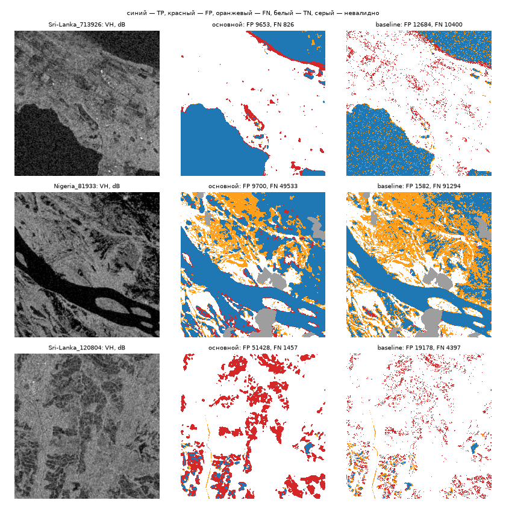

# Итоговая оценка на части `validation`: baseline против основного метода

Сгенерировано `python -m floodvalue eval-test --part validation` (commit `af52cc72a2d6`, 2026-09-25), sha256 конфигурации `506ce620d041373c6b312ead25deed6221e79704fe3ce2fa60d24add0ea31c1e`. Числа — из `eval-validation.csv`, `eval-validation-chips.csv`, `eval-validation-reliability.csv`, `eval-validation-proxy.csv`, `eval-validation-summary.json`.

**Это не итоговая независимая проверка.** Часть `validation` использовалась для настройки (D-012/D-016: dev — выбор модели, validation — калибровка и порог), поэтому прогон проверяет проводку отчёта и даёт ориентир, но не оценку переноса. Test не читался (D-010).

- Основной метод: `unet`, порог p ≥ 0.37 (`calibrated (platt) and chosen on validation, D-029`). Растры — те же, что пишет `make predict`.
- Калибровка: применена в predict.
- Baseline: VH ≤ -23.0 dB (`models/baseline/config.json`).
- Чипов: 60; события: Nigeria, Sri-Lanka.
- Валидный пиксель: VV и VH конечны **и** LabelHand ≠ −1. Маска валидности считается отдельно по растру каждого метода и по S1/метке; `valid_mask_sha256` всех трёх совпал по каждому событию и ALL (иначе запуск падает).
- Сверка baseline с `baseline-metrics.csv`: совпадает (TP/FP/FN/TN и valid_mask_sha256).

## 1. Метрики на идентичных валидных пикселях (критерий 4)

| событие | метод | IoU | F1 | Precision | Recall | TP | FP | FN | TN | пикселей |
|---|---|---|---|---|---|---|---|---|---|---|
| Nigeria | baseline | 0,572 | 0,728 | 0,931 | 0,597 | 565920 | 41768 | 381417 | 3031413 | 4020518 |
| Nigeria | основной | 0,778 | 0,875 | 0,908 | 0,844 | 799659 | 80619 | 147678 | 2992562 | 4020518 |
| Sri-Lanka | baseline | 0,585 | 0,739 | 0,784 | 0,698 | 820372 | 225798 | 355039 | 8562052 | 9963261 |
| Sri-Lanka | основной | 0,621 | 0,766 | 0,742 | 0,791 | 929412 | 322427 | 245999 | 8465423 | 9963261 |
| **ALL** | baseline | 0,580 | 0,734 | 0,838 | 0,653 | 1386292 | 267566 | 736456 | 11593465 | 13983779 |
| **ALL** | основной | 0,685 | 0,813 | 0,811 | 0,815 | 1729071 | 403046 | 393677 | 11457985 | 13983779 |

Парный бутстрэп по чипам (2000 повторов, seed 20260925; одни и те же выборки чипов для обоих методов), ΔIoU = основной − baseline:

| событие | ΔIoU | 95 % CI | доля Δ > 0 |
|---|---|---|---|
| Nigeria | 0,206 | [0,147; 0,250] | 1,000 |
| Sri-Lanka | 0,035 | [−0,010; 0,079] | 0,936 |
| ALL | 0,105 | [0,050; 0,153] | 1,000 |

Интервал считается здесь заново (свои выборки чипов), поэтому может отличаться в третьем знаке от других отчётов; для этой части основным считается этот.

## 2. Ложные срабатывания и пропуски по событиям

| событие | метод | FP | FN | FP / (TP+FP) | FN / (TP+FN) |
|---|---|---|---|---|---|
| Nigeria | baseline | 41768 | 381417 | 0,069 | 0,403 |
| Nigeria | основной | 80619 | 147678 | 0,092 | 0,156 |
| Sri-Lanka | baseline | 225798 | 355039 | 0,216 | 0,302 |
| Sri-Lanka | основной | 322427 | 245999 | 0,258 | 0,209 |
| ALL | baseline | 267566 | 736456 | 0,162 | 0,347 |
| ALL | основной | 403046 | 393677 | 0,189 | 0,185 |

Карты ошибок (`eval-validation-errors.png`): Sri-Lanka_713926, Nigeria_81933, Sri-Lanka_120804 — демо-чип части и чип с наибольшим числом ошибок основного метода в каждом событии.



## 3. Надёжность вероятностей основного метода (критерий 9)

10 равных корзин p на [0; 1], по всем валидным пикселям. ECE = Σ n_b/N · |среднее p − доля воды|; Brier = среднее (p − y)².

| событие | ECE | Brier |
|---|---|---|
| Nigeria | 0,023 | 0,046 |
| Sri-Lanka | 0,011 | 0,039 |
| ALL | 0,007 | 0,041 |

| корзина p | пикселей | среднее p | доля воды |
|---|---|---|---|
| [0,0; 0,1) | 11186329 | 0,019 | 0,018 |
| [0,1; 0,2) | 339519 | 0,143 | 0,222 |
| [0,2; 0,3) | 203553 | 0,248 | 0,315 |
| [0,3; 0,4) | 171859 | 0,349 | 0,396 |
| [0,4; 0,5) | 161460 | 0,450 | 0,440 |
| [0,5; 0,6) | 161509 | 0,550 | 0,488 |
| [0,6; 0,7) | 170638 | 0,651 | 0,568 |
| [0,7; 0,8) | 184005 | 0,750 | 0,673 |
| [0,8; 0,9) | 216698 | 0,854 | 0,827 |
| [0,9; 1,0] | 1188209 | 0,972 | 0,975 |

## 4. Неопределённость на ошибках (критерий 10)

Показатель (временный, до #21) — бинарная энтропия p основного метода в битах: нерешительность модели в пикселе, не проверенная неопределённость. Ошибка — маска основного метода ≠ метке. AUROC — вероятность, что у случайного ошибочного пикселя энтропия выше, чем у случайного верного (0,5 — не различает; по гистограмме с шагом 1e-5 бита).

| событие | ошибочных | верных | средняя H на ошибках | на верных | AUROC H → ошибка |
|---|---|---|---|---|---|
| Nigeria | 228297 | 3792221 | 0,564 | 0,161 | 0,893 |
| Sri-Lanka | 568426 | 9394835 | 0,716 | 0,192 | 0,907 |
| ALL | 796723 | 13187056 | 0,672 | 0,183 | 0,902 |

## 5. Прокси-проверка ущерба (критерий 14) — прокси, не фактические потери

Правило точек: `python -m floodvalue assets` на растре p основного метода этого чипа — то же правило размещения, что у сдаваемого портфеля (seed 20260925, 10 типов из `configs/assets.yaml`, только валидность S1; прогноз, ущерб и метки не читаются). EL = p·V·q из `asset_loss.csv`; EL_ref = y·V·q, y — ручная метка воды в пикселе точки при тех же учебных V и q. Оцениваются только точки со статусом ok и меткой 0/1.

| выборка | точек поставлено | оценено | исключено: метка −1 | исключено: нет p | MAE, руб. | Σ \|EL − EL_ref\|, руб. | Σ EL, руб. | Σ EL_ref, руб. |
|---|---|---|---|---|---|---|---|---|
| демо-чип `Sri-Lanka_713926` | 10 | 10 | 0 | 0 | 274 286 | 2 742 857 | 16 842 208 | 18 000 000 |
| все чипы части, по 10 точек | 600 | 536 | 64 | 0 | 284 926 | 152 720 570 | 311 392 795 | 311 300 000 |

Ошибка — прокси по ручной метке воды, не фактические потери: EL_ref сам зависит от учебных V, q и не наблюдает ущерб. По точкам — `eval-validation-proxy.csv`.

## 6. JRC-диагностика: IoU внутри и вне JRCWaterHand = 1

JRCWaterHand — слой воды набора; вероятно, собран по данным после события, поэтому только диагностика (в метод не подаётся). Внутри JRC = 1 — в основном постоянная вода, вне — то, что ближе к паводку.

| метод | IoU внутри JRC=1 | IoU вне JRC | пикселей внутри | пикселей вне |
|---|---|---|---|---|
| baseline | 0,892 | 0,390 | 918330 | 13065449 |
| основной | 0,951 | 0,535 | 918330 | 13065449 |

## 7. Перенос: каждое событие части — новое событие (критерий 7)

Ни одно событие части не участвовало в обучении (split по событиям, D-016). Метрики по событиям — в разделе 1; ниже — условия, при которых качество падает (пулинг по чипам, построчно — `eval-validation-chips.csv`). Метод работает только по S1: S2, DEM, JRC не подаются.

| группа чипов | чипов | IoU основной | IoU baseline | FP основной | FN основной |
|---|---|---|---|---|---|
| доля воды < 1 % | 18 | 0,270 | 0,143 | 15122 | 9450 |
| доля воды 1–10 % | 25 | 0,271 | 0,265 | 285279 | 84474 |
| доля воды 10–30 % | 7 | 0,480 | 0,379 | 49210 | 135079 |
| доля воды ≥ 30 % | 10 | 0,866 | 0,710 | 53435 | 164674 |
| невалидных пикселей > 10 % | 23 | 0,555 | 0,444 | 63692 | 104435 |
| невалидных пикселей ≤ 10 % | 37 | 0,707 | 0,604 | 339354 | 289242 |

## Воспроизведение

```bash
set -a; . ./.env; set +a
uv run --frozen python -m floodvalue eval-test --part validation
uv run --frozen pytest tests/eval
```
