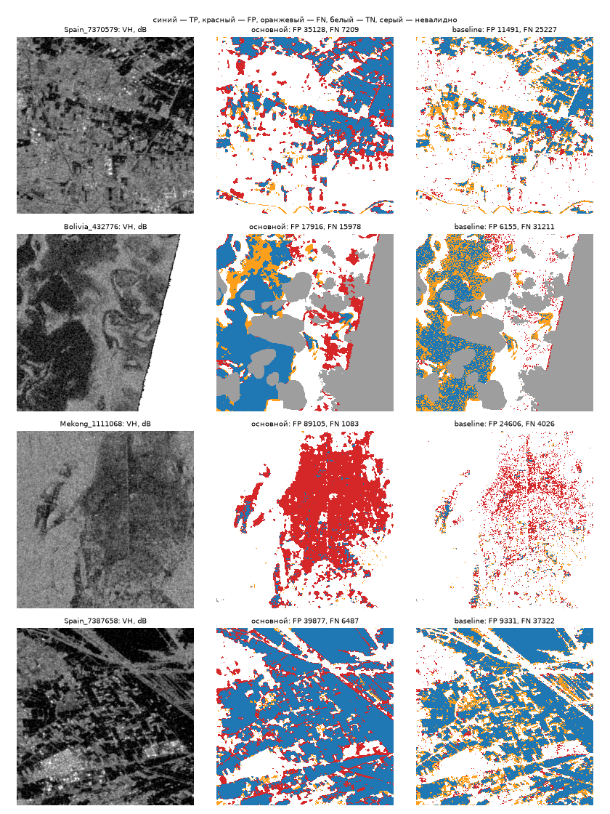

# Итоговая оценка на части `test`: baseline против основного метода

Сгенерировано `python -m floodvalue eval-test --part test` (commit `e7a78e777f88`, 2026-09-26), sha256 конфигурации `e8fa3dae8067cb421e9a4d014c1ccceb90bde83999d40731b229e199ba8931c8`. Числа — из `test-eval.csv`, `test-eval-chips.csv`, `test-eval-reliability.csv`, `test-eval-proxy.csv`, `test-eval-summary.json`, `test-eval-qc.csv`.

Test прочитан один раз замороженной конфигурацией; запуск записан в `docs/verification/test-log.md`.

- Основной метод: `unet`, порог p ≥ 0.37 (`calibrated (platt) and chosen on validation, D-029`). Растры — те же, что пишет `make predict`.
- Калибровка: применена в predict.
- Baseline: VH ≤ -23.0 dB (`models/baseline/config.json`).
- Чипов: 75; события: Bolivia, Mekong, Spain.
- Валидный пиксель: VV и VH конечны **и** LabelHand ≠ −1. Маска валидности считается отдельно по растру каждого метода и по S1/метке; `valid_mask_sha256` всех трёх совпал по каждому событию и ALL (иначе запуск падает).
- Сверка baseline с `baseline-metrics.csv`: не применимо.

## 1. Метрики на идентичных валидных пикселях (критерий 4)

| событие | метод | IoU | F1 | Precision | Recall | TP | FP | FN | TN | пикселей |
|---|---|---|---|---|---|---|---|---|---|---|
| Bolivia | baseline | 0,581 | 0,735 | 0,856 | 0,644 | 291176 | 48928 | 160725 | 2323605 | 2824434 |
| Bolivia | основной | 0,688 | 0,815 | 0,795 | 0,837 | 378095 | 97743 | 73806 | 2274790 | 2824434 |
| Mekong | baseline | 0,766 | 0,867 | 0,955 | 0,795 | 1366913 | 64978 | 353013 | 5345016 | 7129920 |
| Mekong | основной | 0,823 | 0,903 | 0,864 | 0,945 | 1625850 | 254855 | 94076 | 5155139 | 7129920 |
| Spain | baseline | 0,597 | 0,747 | 0,701 | 0,800 | 812922 | 346071 | 203578 | 6365231 | 7727802 |
| Spain | основной | 0,613 | 0,760 | 0,635 | 0,946 | 961836 | 552244 | 54664 | 6159058 | 7727802 |
| **ALL** | baseline | 0,677 | 0,808 | 0,843 | 0,775 | 2471011 | 459977 | 717316 | 14033852 | 17682156 |
| **ALL** | основной | 0,725 | 0,840 | 0,766 | 0,930 | 2965781 | 904842 | 222546 | 13588987 | 17682156 |

Парный бутстрэп по чипам (2000 повторов, seed 20260925; одни и те же выборки чипов для обоих методов), ΔIoU = основной − baseline:

| событие | ΔIoU | 95 % CI | доля Δ > 0 |
|---|---|---|---|
| Bolivia | 0,107 | [0,078; 0,131] | 1,000 |
| Mekong | 0,057 | [−0,021; 0,112] | 0,937 |
| Spain | 0,017 | [−0,010; 0,048] | 0,893 |
| ALL | 0,047 | [0,012; 0,079] | 0,996 |

Интервал считается здесь заново (свои выборки чипов), поэтому может отличаться в третьем знаке от других отчётов; для этой части основным считается этот.

## 2. Ложные срабатывания и пропуски по событиям

| событие | метод | FP | FN | FP / (TP+FP) | FN / (TP+FN) |
|---|---|---|---|---|---|
| Bolivia | baseline | 48928 | 160725 | 0,144 | 0,356 |
| Bolivia | основной | 97743 | 73806 | 0,205 | 0,163 |
| Mekong | baseline | 64978 | 353013 | 0,045 | 0,205 |
| Mekong | основной | 254855 | 94076 | 0,136 | 0,055 |
| Spain | baseline | 346071 | 203578 | 0,299 | 0,200 |
| Spain | основной | 552244 | 54664 | 0,365 | 0,054 |
| ALL | baseline | 459977 | 717316 | 0,157 | 0,225 |
| ALL | основной | 904842 | 222546 | 0,234 | 0,070 |

Карты ошибок (`test-eval-errors.png`): Spain_7370579, Bolivia_432776, Mekong_1111068, Spain_7387658 — демо-чип части и чип с наибольшим числом ошибок основного метода в каждом событии.



## 3. Надёжность вероятностей основного метода (критерий 9)

15 равных корзин p на [0; 1] — те же, что в калибровке (`calibration.json`, `calibration-val.md`), по всем валидным пикселям. ECE = Σ n_b/N · |среднее p − доля воды|; MCE — максимум |среднее p − доля воды| по непустым корзинам (чувствителен к малым корзинам, см. число пикселей ниже); Brier = среднее (p − y)²; log-loss — среднее −ln p(y), p обрезана до [1e-6; 1 − 1e-6] как в калибровке. 95 % CI — бутстрэп по чипам (2000 повторов, seed 20260925): чипы выбираются с возвращением, пиксели выбранных чипов объединяются.

| событие | ECE | 95 % CI ECE | MCE | Brier | log-loss | 95 % CI log-loss | среднее p | доля воды |
|---|---|---|---|---|---|---|---|---|
| Bolivia | 0,0263 | [0,0164; 0,0476] | 0,1300 | 0,0462 | 0,1701 | [0,1058; 0,2461] | 0,156 | 0,160 |
| Mekong | 0,0273 | [0,0156; 0,0493] | 0,3232 | 0,0336 | 0,1203 | [0,0834; 0,1670] | 0,266 | 0,241 |
| Spain | 0,0788 | [0,0675; 0,0897] | 0,5236 | 0,0495 | 0,1835 | [0,1445; 0,2238] | 0,210 | 0,132 |
| ALL | 0,0436 | [0,0304; 0,0559] | 0,2722 | 0,0425 | 0,1559 | [0,1287; 0,1843] | 0,224 | 0,180 |

| корзина p | пикселей | среднее p | доля воды |
|---|---|---|---|
| [0,000; 0,067) | 12017605 | 0,021 | 0,004 |
| [0,067; 0,133) | 873051 | 0,094 | 0,055 |
| [0,133; 0,200) | 396160 | 0,164 | 0,096 |
| [0,200; 0,267) | 251405 | 0,231 | 0,133 |
| [0,267; 0,333) | 186846 | 0,299 | 0,172 |
| [0,333; 0,400) | 151578 | 0,366 | 0,213 |
| [0,400; 0,467) | 133708 | 0,433 | 0,250 |
| [0,467; 0,533) | 123968 | 0,500 | 0,288 |
| [0,533; 0,600) | 120671 | 0,567 | 0,331 |
| [0,600; 0,667) | 128030 | 0,634 | 0,392 |
| [0,667; 0,733) | 144237 | 0,701 | 0,452 |
| [0,733; 0,800) | 174576 | 0,768 | 0,509 |
| [0,800; 0,867) | 226257 | 0,835 | 0,563 |
| [0,867; 0,933) | 303870 | 0,902 | 0,662 |
| [0,933; 1,000] | 2450194 | 0,990 | 0,942 |

### 3a. Сырая p → калиброванная p на тех же пикселях

Сырая p — `predict_proba` основного метода (контракт §3; у U-Net — среднее членов ансамбля до калибратора), калиброванная — сдаваемый `flood_probability.tif` (калибратор `platt` из `models/unet/calibration.json`, подобран на validation, D-029). Для каждого чипа проверено, что сырая p через калибратор даёт сдаваемую p (|Δ| ≤ 1e-6). Отчёт, ничего не выбирается.

| событие | p | ECE | MCE | Brier | log-loss | среднее p | доля воды |
|---|---|---|---|---|---|---|---|
| Bolivia | сырая | 0,0734 | 0,3927 | 0,0643 | 0,2076 | 0,110 | 0,160 |
| Bolivia | калиброванная | 0,0263 | 0,1300 | 0,0462 | 0,1701 | 0,156 | 0,160 |
| Mekong | сырая | 0,0324 | 0,1657 | 0,0323 | 0,1223 | 0,232 | 0,241 |
| Mekong | калиброванная | 0,0273 | 0,3232 | 0,0336 | 0,1203 | 0,266 | 0,241 |
| Spain | сырая | 0,0432 | 0,2042 | 0,0318 | 0,1244 | 0,175 | 0,132 |
| Spain | калиброванная | 0,0788 | 0,5236 | 0,0495 | 0,1835 | 0,210 | 0,132 |
| ALL | сырая | 0,0217 | 0,0645 | 0,0372 | 0,1368 | 0,188 | 0,180 |
| ALL | калиброванная | 0,0436 | 0,2722 | 0,0425 | 0,1559 | 0,224 | 0,180 |

## 4. Неопределённость на ошибках (критерий 10)

Показатель — бинарная энтропия сдаваемой (калиброванной) p основного метода в битах; тот же показатель, что в `uncertainty.tif` комплекта. Выбран по правилу `models/unet/uncertainty.json` (D-039: максимум AUROC худшего события validation; более простой показатель побеждает, если CI разности содержит 0). Статус из файла: связь с ошибками проверена на validation (часть подбора калибровки и порога) и на dev (USA: в выборе показателя и калибровке не участвовал, но на нём выбиралась эпоха модели, D-019); на test не проверено до eval-test. На test связь с ошибками проверяется впервые и независимо. Ошибка — маска основного метода ≠ метке. AUROC — вероятность, что у случайного ошибочного пикселя энтропия выше, чем у случайного верного (0,5 — не различает; по гистограмме с шагом 1e-5 бита).

| событие | ошибочных | верных | средняя H на ошибках | на верных | AUROC H → ошибка |
|---|---|---|---|---|---|
| Bolivia | 171549 | 2652885 | 0,703 | 0,222 | 0,879 |
| Mekong | 348931 | 6780989 | 0,681 | 0,157 | 0,928 |
| Spain | 606908 | 7120894 | 0,712 | 0,229 | 0,878 |
| ALL | 1127388 | 16554768 | 0,701 | 0,198 | 0,897 |

## 5. Прокси-проверка ущерба (критерий 14) — прокси, не фактические потери

Правило точек: `python -m floodvalue assets` на растре p основного метода этого чипа — то же правило размещения, что у сдаваемого портфеля (seed 20260925, 10 типов из `configs/assets.yaml`, только валидность S1; прогноз, ущерб и метки не читаются). EL = p·V·q из `asset_loss.csv`; EL_ref = y·V·q, y — ручная метка воды в пикселе точки при тех же учебных V и q. Оцениваются только точки со статусом ok и меткой 0/1.

| выборка | точек поставлено | оценено | исключено: метка −1 | исключено: нет p | MAE, руб. | Σ \|EL − EL_ref\|, руб. | Σ EL, руб. | Σ EL_ref, руб. |
|---|---|---|---|---|---|---|---|---|
| демо-чип `Spain_7370579` | 10 | 10 | 0 | 0 | 468 044 | 4 680 440 | 8 252 216 | 3 600 000 |
| все чипы части, по 10 точек | 750 | 693 | 57 | 0 | 345 305 | 239 296 312 | 585 567 944 | 448 500 000 |

Ошибка — прокси по ручной метке воды, не фактические потери: EL_ref сам зависит от учебных V, q и не наблюдает ущерб. По точкам — `test-eval-proxy.csv`.

## 6. JRC-диагностика: IoU внутри и вне JRCWaterHand = 1

JRCWaterHand — слой воды набора; вероятно, собран по данным после события, поэтому только диагностика (в метод не подаётся). Внутри JRC = 1 — в основном постоянная вода, вне — то, что ближе к паводку.

| метод | IoU внутри JRC=1 | IoU вне JRC | пикселей внутри | пикселей вне |
|---|---|---|---|---|
| baseline | 0,971 | 0,577 | 942114 | 16740042 |
| основной | 0,987 | 0,647 | 942114 | 16740042 |

## 7. Перенос: каждое событие части — новое событие (критерий 7)

Ни одно событие части не участвовало в обучении (split по событиям, D-016). Метрики по событиям — в разделе 1; ниже — условия, при которых качество падает (пулинг по чипам, построчно — `test-eval-chips.csv`). Метод работает только по S1: S2, DEM, JRC не подаются.

| группа чипов | чипов | IoU основной | IoU baseline | FP основной | FN основной |
|---|---|---|---|---|---|
| доля воды < 1 % | 16 | 0,065 | 0,037 | 76366 | 5803 |
| доля воды 1–10 % | 30 | 0,343 | 0,315 | 386664 | 59291 |
| доля воды 10–30 % | 10 | 0,665 | 0,640 | 163573 | 28882 |
| доля воды ≥ 30 % | 19 | 0,852 | 0,779 | 278239 | 128570 |
| невалидных пикселей > 10 % | 26 | 0,794 | 0,773 | 181095 | 76174 |
| невалидных пикселей ≤ 10 % | 49 | 0,694 | 0,634 | 723747 | 146372 |

### 7a. Климат Кёппена события: виден ли он в обучении

Класс Кёппена — атрибут места события, не метка и не прогноз; таблица событие → класс (Ratté-Fortin et al., SSRN 6282373, табл. 2) и эта группировка зафиксированы до запуска на test (#150). Train: Ghana Aw, India Am, Pakistan BWh, Paraguay Cfa, Somalia BSh; dev: USA Dfa; validation: Nigeria Aw, Sri-Lanka Am. «Виден» — класс есть среди событий train. Столбец `koppen` — в `test-eval-chips.csv`.

| группа чипов | события | класс в train | чипов | IoU основной | IoU baseline | FP основной | FN основной |
|---|---|---|---|---|---|---|---|
| Кёппен Am | Bolivia, Mekong | да | 45 | 0,794 | 0,725 | 352598 | 167882 |
| Кёппен Csa | Spain | нет | 30 | 0,613 | 0,597 | 552244 | 54664 |
| климат не виден в train | Spain | нет | 30 | 0,613 | 0,597 | 552244 | 54664 |
| климат виден в train | Bolivia, Mekong | да | 45 | 0,794 | 0,725 | 352598 | 167882 |

## 8. Пиксельный QC чипов части (критерий 1)

Считается в том же цикле по чипам из тех же массивов S1 и LabelHand, без второго чтения; построчно — `test-eval-qc.csv`. NaN S1 — хотя бы один канал не конечен; доли NaN и −1 — от всех пикселей; VV/VH > 0 dB — среди конечных пикселей канала; «NaN S1 под 0/1» — пиксели с не конечным S1 и меткой 0 или 1 (исключаются маской валидности). Доля воды — в метриках, не QC.

| событие | чипов | NaN S1, % | −1, % | VV > 0 dB, % | VH > 0 dB, % | NaN S1 под 0/1, пикс. | чипов с NaN под 0/1 | чипов с NaN |
|---|---|---|---|---|---|---|---|---|
| Bolivia | 15 | 10,33 | 27,07 | 0,00 | 0,00 | 43381 | 5 | 8 |
| Mekong | 30 | 0,02 | 9,32 | 0,04 | 0,00 | 1262 | 3 | 3 |
| Spain | 30 | 0,00 | 1,74 | 1,25 | 0,04 | 0 | 0 | 0 |
| ALL | 75 | 2,07 | 9,84 | 0,53 | 0,02 | 44643 | 8 | 11 |

## Воспроизведение

```bash
set -a; . ./.env; set +a
uv run --frozen python -m floodvalue eval-test --part test
uv run --frozen pytest tests/eval
```
