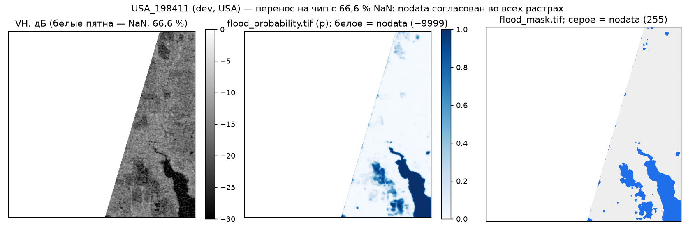
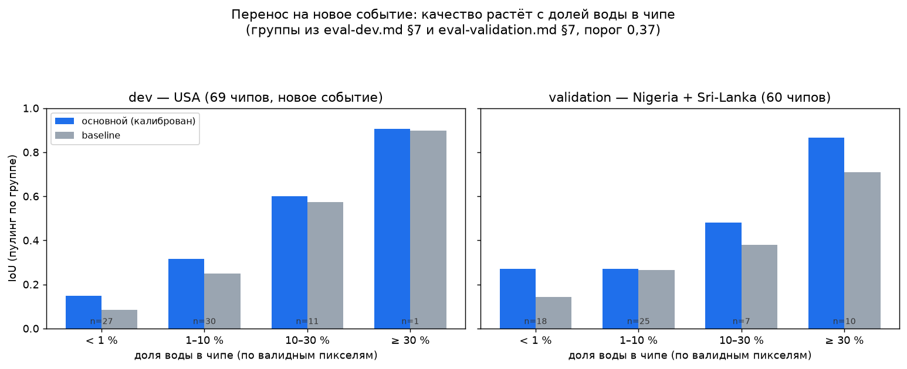
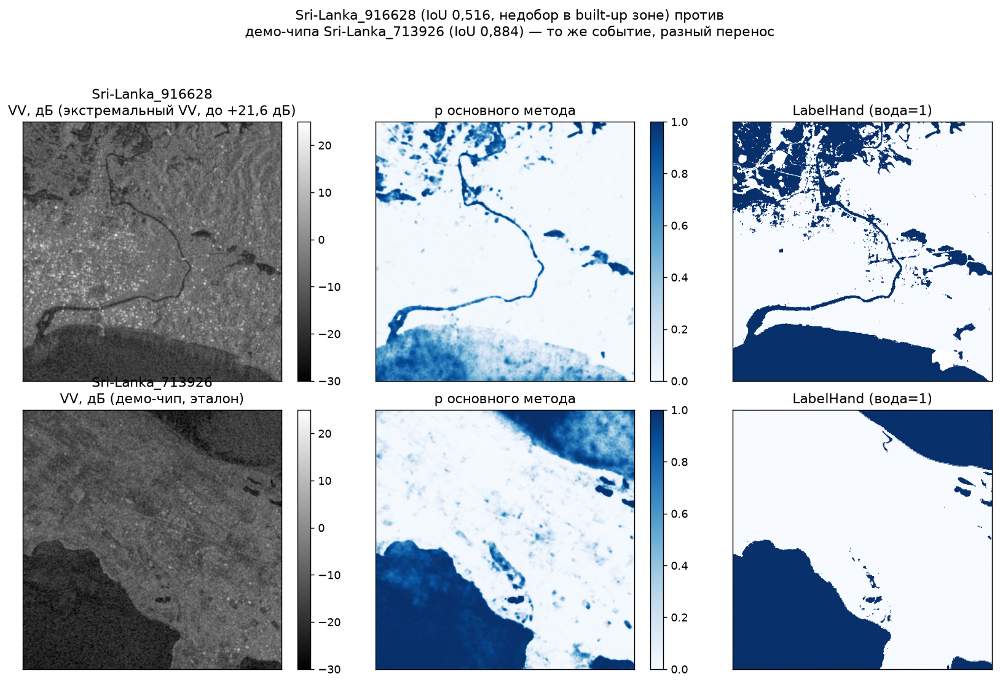

# Перенос на другие официальные S1-чипы (issue #27, критерии 7 и 11)

Проверка **до заморозки**: зафиксированный основной метод (D-019 U-Net-ансамбль + D-029
калибровка Platt, порог 0,37 — как в `main`, **без подгонки под чип**) запущен сквозным путём
`make all CHIP=<chip> BUDGET=5000` на 4 официальных чипах Sen1Floods11, включая демо-чип `configs/run.yaml`
(`Sri-Lanka_713926` — чистый эталон для сравнения; остальные три — чипы, отличные от
демо). Все 4 чипа — **только из `dev`/`validation`** (`splits/split_v1.json`, D-016):
USA (dev), Nigeria и Sri-Lanka (validation). **Test (Spain/Mekong/Bolivia) не читался** —
перенос на него будет отдельно, в `eval-test --part test` после заморозки (issue #32, D-010).

Метод не менялся и не переобучался: `models/unet/config.json` (`weights_sha256
504944cd880c0b2e94acf2481e6ddc4db985ddbd64d550a3591321e8b0cc1bb3`) и `models/unet/calibration.json`
(Platt `a=1.4647, b=1.5210`, порог `0.37`, D-029) — те же файлы, что в `main` на момент
запуска (commit `81564dbf930c`, 2026-09-25). Все команды ниже — из этого worktree,
после `set -a; . ./.env; set +a`.

## 1. Выбор чипов

Найдено по `$FLOODVALUE_DATA_DIR/interim/qc.csv` (D-015) среди событий `USA`, `Nigeria`,
`Sri-Lanka` — картина сознательно разная: один чип с настоящей дырой NaN, один с
экстремально низким VH, один с экстремально высоким VV, один «чистый» эталон.

| chip_id | часть/событие | зачем выбран | доля NaN в S1 (vv=vh) | доля невалидных меток | VV мин/медиана/макс, дБ | VH мин/медиана/макс, дБ |
|---|---|---|---|---|---|---|
| `USA_198411` | dev / USA | наибольшая доля NaN среди dev/validation/USA/Nigeria/Sri-Lanka | 0,6656 | 0,6787 | −39,55 / −11,27 / +3,60 | −47,40 / −16,82 / −4,86 |
| `Nigeria_81933` | validation / Nigeria | экстремально низкий VH (почти минимум по трём событиям) | 0 | 0,0606 | −39,12 / −13,99 / +6,38 | **−58,08** / −19,50 / −4,76 |
| `Sri-Lanka_916628` | validation / Sri-Lanka | экстремально высокий VV (застройка) и низкий VH | 0 | 0,0083 | −29,59 / −8,06 / **+21,58** | −47,76 / −15,12 / +5,50 |
| `Sri-Lanka_713926` | validation / Sri-Lanka | демо-чип `configs/run.yaml` — чистый эталон того же события | 0 | 0,0002 | −48,35 / −12,74 / +14,20 | −54,38 / −19,36 / +7,58 |

Диапазон дБ по всему набору (`docs/data.md` §11): VV от −89,8 до +36,8, VH от −103,9 до
+17,4 — `Nigeria_81933` и `Sri-Lanka_916628` попадают в «хвосты» этого диапазона, не в
центр распределения, поэтому годятся как стресс-случаи переноса.

## 2. Сквозной прогон: команды и вывод

```bash
set -a; . ./.env; set +a
for c in USA_198411 Nigeria_81933 Sri-Lanka_916628 Sri-Lanka_713926; do
  make all CHIP=$c BUDGET=5000
done
```

Вывод (сокращённо, полностью — стандартный вывод каждого этапа, как в README):

```
=== USA_198411 ===
{"chip_id": "USA_198411", "method": "unet", "threshold": 0.37,
 "threshold_status": "calibrated (platt) and chosen on validation, D-029",
 "calibration": {"kind": "platt"}, "valid_pixels": 87651, "seconds": 1.5}
procure: A: данные 0.00 руб., в бюджете True, охват EL 0.00 руб.
procure: B: данные 33775.84 руб., в бюджете False, охват EL 4434415.20 руб., зоны ['W-CHIP']
procure: C: данные 4905.96 руб., в бюджете True, охват EL 3798297.68 руб., зоны ['Z-A06', 'Z-A02']
export: комплект USA_198411_5000_81564db -> outputs/USA_198411_5000_81564db
OK x12 -> 12/12 файлов прошли проверку

=== Nigeria_81933 ===
{"chip_id": "Nigeria_81933", ..., "valid_pixels": 262144, "seconds": 1.74}
procure: B: охват EL 13079124.26 руб.; C: данные 4905.96 руб., охват EL 10692832.06 руб.
export: комплект Nigeria_81933_5000_81564db -> outputs/Nigeria_81933_5000_81564db
OK x12 -> 12/12 файлов прошли проверку

=== Sri-Lanka_916628 ===
{"chip_id": "Sri-Lanka_916628", ..., "valid_pixels": 262144, "seconds": 2.15}
procure: B: охват EL 8844166.02 руб.; C: данные 4905.96 руб., охват EL 8054372.73 руб.
export: комплект Sri-Lanka_916628_5000_81564db -> outputs/Sri-Lanka_916628_5000_81564db
OK x12 -> 12/12 файлов прошли проверку

=== Sri-Lanka_713926 ===
{"chip_id": "Sri-Lanka_713926", ..., "valid_pixels": 262144, "seconds": 1.74}
procure: B: охват EL 16842207.72 руб.; C: данные 4905.96 руб., охват EL 12610565.84 руб.
export: комплект Sri-Lanka_713926_5000_81564db -> outputs/Sri-Lanka_713926_5000_81564db
OK x12 -> 12/12 файлов прошли проверку
```

Порог во всех четырёх запусках — `0.37`, `threshold_status` — тот же
`"calibrated (platt) and chosen on validation, D-029"`: **порог и калибратор не
менялись между чипами**, как того требует критерий 7 («без подгонки»). Явный повторный
`make validate` на каждом комплекте (сверх того, что уже входит в `make all`):

```bash
$ make validate OUT=outputs/USA_198411_5000_81564db
Комплект: outputs/USA_198411_5000_81564db
OK   flood_probability.tif
OK   flood_mask.tif
... (12 строк OK)
12/12 файлов прошли проверку
```

— тот же результат `12/12` на всех четырёх комплектах (включая демо-чип `Sri-Lanka_713926`).

## 3. Nodata: `USA_198411` (66,6 % NaN)

`flood_probability.tif`/`flood_mask.tif` (docs/contracts.md §2) проверены напрямую (`rasterio`):

| chip_id | nodata в S1 (пикселей) | `flood_probability.tif` = −9999 | `flood_mask.tif` = 255 | совпадают |
|---|---|---|---|---|
| `USA_198411` | 174 493 / 262 144 (66,56 %) | 174 493 | 174 493 | да |
| `Nigeria_81933` | 0 | 0 | 0 | да |
| `Sri-Lanka_916628` | 0 | 0 | 0 | да |
| `Sri-Lanka_713926` | 0 | 0 | 0 | да |



**Портфель на чипе с дырой:** 10/10 объектов `USA_198411` получили `status=ok` в
`asset_loss.csv` (как и на остальных трёх чипах). Это не случайность: правило размещения
(`floodvalue/assets/portfolio.py`, `PLACEMENT_RULE`) перебрасывает объект, пока пиксель — S1
nodata (VV или VH не конечны), поэтому валидные 33,4 % чипа хватает на 10 объектов и в
`no_data` они не попадают по построению. Сам код пути `status=no_data` (пустые
`p_flood`/`expected_loss_rub`/`uncertainty`/`rank` при попадании в nodata растра) отдельно
и напрямую проверен юнит-тестом
`tests/assets/test_run.py::test_run_no_data_asset_has_empty_fields` — здесь дополнительно
подтверждено, что на **реальном** сильно-NaN чипе он просто не понадобился, а−9999/255
дошли до сдаваемых растров корректно.

## 4. Режим S1-only

Ни `predict` (основной метод и baseline), ни `assets`, ни `procurement` не читают
`S2Hand`/`JRCWaterHand`/`LabelHand` — только `S1Hand` и (в `assets`) уже посчитанный
`flood_probability.tif`:

```bash
$ grep -rn "S2Hand\|JRCWaterHand\|load_label" \
    src/floodvalue/model/predict.py src/floodvalue/model/unet/predict.py \
    src/floodvalue/assets/*.py src/floodvalue/procurement/*.py src/floodvalue/export/*.py
# (пусто)
```

Подтверждено и практическим запуском: `$FLOODVALUE_DATA_DIR` временно подменён на
изолированный каталог, где на диске лежит **только** `S1Hand` чипа `Nigeria_81933`
(без `S2Hand`, `JRCWaterHand`, `LabelHand`) и обрезанный `source_manifest_s1.json`:

```bash
$ export FLOODVALUE_DATA_DIR=/tmp/.../s1only_data FLOODVALUE_OUTPUT_DIR=/tmp/.../s1only_out
$ find "$FLOODVALUE_DATA_DIR" -iname "*S2*" -o -iname "*JRC*"; echo "искали — ничего"
искали — ничего
$ uv run --frozen python -m floodvalue predict --chip Nigeria_81933
{"chip_id": "Nigeria_81933", "method": "unet", "threshold": 0.37, "valid_pixels": 262144, ...}
$ uv run --frozen python -m floodvalue assets --chip Nigeria_81933 --budget 5000
assets: 10 объектов, оценено 10, файлы в .../s1only_out/Nigeria_81933
$ uv run --frozen python -m floodvalue procure --chip Nigeria_81933 --budget 5000
procure: B: охват EL 13079124.26 руб.; C: охват EL 10692832.06 руб.   # те же числа, что с полным data/
$ uv run --frozen python -m floodvalue export --chip Nigeria_81933 --budget 5000
$ uv run --frozen python -m floodvalue validate
12/12 файлов прошли проверку
```

Числа (EL, зоны A/B/C, охват) совпали байт-в-байт с прогоном на полном `data/` — S1-only
не деградация, а тот же путь без S2/JRC на диске вовсе. Регрессионно это закрыто тестом
`tests/eval/test_transfer_chip.py::test_s1_only_no_s2_or_jrc_files_anywhere_in_data_dir`
(синтетический чип, каталог данных без единого файла S2/JRC/label).

## 5. Метрики переноса по событиям (критерий 7)

Источники: `docs/verification/calibration-val.md` (validation, уже с калибровкой) и
`python -m floodvalue eval-test --part dev` (запущено 2026-09-25 при commit `81564dbf930c`,
sha256 конфигурации `506ce620d041373c6b312ead25deed6221e79704fe3ce2fa60d24add0ea31c1e`
— тот же сквозной путь, что у `predict`/`make all`, метки dev/validation читать разрешено,
D-010 запечатывает только test). Результат команды — `docs/verification/eval-dev.md`
(+ `eval-dev.csv`, `-chips.csv`, `-summary.json`; перегенерирован 2026-09-26 на commit
`23e3e9215d72` с тем же sha256 конфигурации, числа совпали); validation — также
`docs/verification/eval-validation.md` §1.

**Ни dev, ни validation — не «новое событие» в строгом смысле:** чекпойнт U-Net выбирался
по IoU на dev (D-019), калибратор и порог — на validation (D-029). Это проверка
воспроизводимости и условий деградации без подгонки под чип, а не независимая оценка
переноса; она будет только на test (`eval-test --part test`, #32).

| событие | часть | метод | IoU | F1 | Precision | Recall | ΔIoU к baseline | 95 % CI (бутстрэп, чипы) |
|---|---|---|---|---|---|---|---|---|
| Nigeria | validation | основной (калиброван) | 0,778 | 0,875 | 0,908 | 0,844 | +0,206 | [+0,147; +0,250] |
| Sri-Lanka | validation | основной (калиброван) | 0,621 | 0,766 | 0,742 | 0,791 | +0,035 | [−0,010; +0,079] |
| **validation ALL** | validation | основной (калиброван) | 0,685 | 0,813 | 0,811 | 0,815 | +0,105 | [+0,050; +0,153] |
| USA | dev | основной (калиброван) | 0,467 | 0,636 | 0,504 | 0,863 | +0,076 | [+0,047; +0,107] |

Числа validation здесь — калиброванные (текущий `predict`, D-029 подключена); они
совпадают с «стало» из `calibration-val.md` и с `eval-validation.md` §1 (перегенерирован
после подключения калибровки в `predict`, #20). Группы dev в §6.1–6.2 — из
`eval-dev.md` (таблица групп чипов), validation — из `eval-validation.md`.

Показатель на dev ниже, чем на validation, ожидаемо: калибратор подобран на доле воды
validation (15,2 %), а на USA (dev) она втрое меньше (4,6 %, `docs/decisions.md` D-029
«Ограничение»); это уже задокументированная, а не новая деградация.

## 6. Причины ошибок и условия снижения качества

### 6.1 Доля воды в чипе



| группа (доля воды) | dev IoU осн. / baseline (n чипов) | validation IoU осн. / baseline (n чипов) |
|---|---|---|
| < 1 % | 0,149 / 0,084 (27) | 0,270 / 0,143 (18) |
| 1–10 % | 0,317 / 0,250 (30) | 0,271 / 0,265 (25) |
| 10–30 % | 0,601 / 0,574 (11) | 0,480 / 0,379 (7) |
| ≥ 30 % | 0,907 / 0,897 (1 чип — не показатель) | 0,866 / 0,710 (10) |

Оба события подтверждают одну и ту же зависимость: **чем меньше доли воды в чипе, тем
ниже IoU** (несколько неверных пикселей резко меняют отношение пересечения к
объединению) — это структурное свойство метрики IoU на разреженных масках, не брак
метода. Основной метод выигрывает у baseline в каждой группе dev и почти в каждой
группе validation (кроме почти равной 1–10 %).

### 6.2 Доля невалидных пикселей (nodata + метка −1)

| часть | невалидных > 10 % | невалидных ≤ 10 % |
|---|---|---|
| dev | IoU 0,247 (4 чипа) | IoU 0,472 (65 чипов) |
| validation | IoU 0,555 (23 чипа) | IoU 0,707 (37 чипов) |

Подтверждает `USA_198411` (66,6 % NaN, IoU чипа 0,532 — ниже, чем у чистых чипов того
же события) — большая доля nodata сама по себе снижает измеримое качество (меньше
контекста модели, меньше валидных пикселей для расчёта IoU), а не просто маскирует его.

### 6.3 Экстремальные дБ и тип поверхности



`Sri-Lanka_916628` (VV до +21,6 дБ — плотная застройка, боковое рассеяние) и
`Sri-Lanka_713926` (демо-чип, тот же событие, без экстремумов) дают очень разные IoU
чипа: **0,516 против 0,884** при одинаковых пороге/калибраторе/событии. По картам видно
конкретный механизм: `LabelHand` относит крупный участок застройки к воде (левый верхний
угол верхнего ряда), а модель по S1 там даёт низкую p — типичная для SAR ошибка
пропуска (FN) на застроенной/сильно текстурированной поверхности, не на открытой воде:
на этом чипе FN 38 964 против FP 1 011 (`eval-validation-chips.csv`, перегенерировано,
см. §5), то есть модель систематически **недооценивает** воду там, где обычный сигнал
VH «нет воды» конфликтует с разметкой. `Nigeria_81933` (VH до −58,08 дБ — очень сухая
суша либо избыточный шум) отработал, напротив, хорошо (IoU чипа 0,684, событие IoU
0,778) — экстремум VH сам по себе не деградирует качество, деградирует сочетание
экстремума с плотной застройкой/сложной геометрией берега.

**Условия снижения качества (сводно, критерий 7):**
1. доля воды в чипе < 10 % — IoU объединения падает вдвое-втрое относительно чипов с
   долей воды ≥ 30 %, на обоих проверенных событиях;
2. доля невалидных (nodata + метка −1) пикселей > 10 % — IoU ниже на 0,15–0,23, чем на
   чистых чипах того же события;
3. плотная застройка с экстремально высоким VV — систематический недобор (высокий FN,
   низкий FP) на границе воды и застройки;
4. событие с долей воды далеко от 15,2 % (доля validation, на которой калиброван
   порог) — например dev (4,6 %) — калибратор завышает p, IoU ниже, чем без
   калибровки (`calibration-val.md`, уже задокументировано в D-029).

## 7. Известное ограничение: `decision_at`/`decision_deadline` не следуют за `--chip` (#84)

Не баг этой задачи (код `procurement`/`export` вне разрешённых путей #27), но важно для
честной интерпретации A/B/C при переносе: `decision_at`/`decision_deadline` в
`run_metadata.json.budget` берутся из `configs/run.yaml` **независимо от `--chip`**
(`floodvalue/procurement/run.py: run_config()` не принимает `chip_id`). У `Sri-Lanka_*`
чипов это совпадает с реальной датой события (то же событие, что в `run.yaml`), а у
`USA_198411`/`Nigeria_81933` — нет:

| chip_id | `event_date` (из `source_manifest_s1.json`, per-chip, верно) | `budget.decision_at`/`decision_deadline` (из `run.yaml`, не привязано к чипу) |
|---|---|---|
| `USA_198411` | 2019-05-22 | 2017-05-30T12:00 / 2017-05-31T00:00 (чужая дата) |
| `Nigeria_81933` | 2018-09-21 | 2017-05-30T12:00 / 2017-05-31T00:00 (чужая дата) |
| `Sri-Lanka_916628` | 2017-05-30 | 2017-05-30T12:00 / 2017-05-31T00:00 (совпадает) |
| `Sri-Lanka_713926` | 2017-05-30 | 2017-05-30T12:00 / 2017-05-31T00:00 (совпадает) |

`flood_probability.tif`/`flood_mask.tif`/`asset_loss.csv` (p, EL, объекты) от этого не
зависят и остаются верными для нового чипа; неверной может стать только сценарная
«свежесть»/охват A/B/C (какие архивные снимки считаются уже доступными к
`decision_deadline`). Для реалистичного A/B/C на другом событии оператору нужно
отредактировать `decision_at`/`decision_deadline` в `configs/run.yaml` перед `procure` —
это стоит явно сказать в README (сделано, §8 ниже).

## 8. README

Добавлен подраздел «Полный запуск на другом официальном чипе» (в разделе «S1-only и выбор метода») с командой
`make all CHIP=<chip_id> BUDGET=<руб>` и предупреждением про `decision_at`/§7 выше.

## 9. Прочее замеченное (не относится к переносу, для честности)

Первый прогон (commit `af52cc72a2d6`, до влития #62) печатал на всех чипах прогона
предупреждение `docs/verification/unet-metrics.csv: порог строк main ['0.5'] ≠ порогу
комплекта 0.37 — метрики не соответствуют маске` (`export` брал `main`-строки
`metrics.csv` из сырых `unet-metrics.csv`, не из `calibration/unet-metrics.csv`; уже
отслеженная проблема, `docs/tz-compliance.md` критерий 5) — не специфично для переноса.
После `git merge origin/main` (#62 объединён) все чипы §2 перезапущены на commit
`81564dbf930c`: предупреждение пропало, `metrics.csv` main берёт калиброванный порог
0,37 без расхождения; числа EL/зон/nodata — те же, что до слияния (export копирует
готовые файлы, не пересчитывает).

## Воспроизведение

```bash
set -a; . ./.env; set +a
for c in USA_198411 Nigeria_81933 Sri-Lanka_916628 Sri-Lanka_713926; do
  make all CHIP=$c BUDGET=5000
  make validate OUT=outputs/${c}_5000_$(git rev-parse --short=7 HEAD)
done
uv run --frozen python -m floodvalue eval-test --part dev          # §5, пишет docs/verification/eval-dev.md
uv run --frozen pytest tests/eval/test_transfer_chip.py -v          # §3, §4
```
