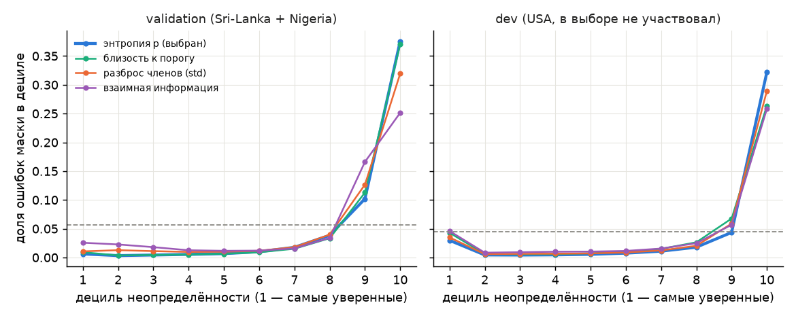
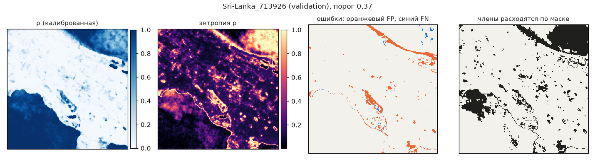

# Неопределённость основного метода: выбор показателя и проверка на ошибках

Сгенерировано `python -m floodvalue.calibration.uncertainty_val --assets-run outputs/Sri-Lanka_713926_5000_9d7201d` (commit `9d7201d5955c`, 2026-09-25). Числа — из результата прогона, `uncertainty/uncertainty-scopes.csv`, `uncertainty/uncertainty-deciles.csv`; решение — D-039. Test не читался (D-010).

- Метод: `unet`, членов ансамбля: 5; калибратор и порог — `models/unet/calibration.json` (D-029), порог маски p ≥ 0,37.
- Чипов: validation 60, dev 69. Валидный пиксель: S1 конечен и LabelHand ≠ −1. **Ошибка** — маска основного метода ≠ метке. **Нестабильный результат** — члены ансамбля расходятся по маске: min q_k < порог ≤ max q_k.
- Показатель — свойство модели, а не наблюдение: его связь с ошибками здесь **проверена** на validation (использованной для калибровки и порога) и на dev (USA: не участвовал ни в калибровке, ни в выборе показателя, но на нём выбиралась эпоха модели, D-019 — от модели он не независим). На test показатель **не проверен**, пока не запущен `make eval-test` (тот же показатель: энтропия сдаваемой p).

## 1. Кандидаты и правило выбора (зафиксированы до расчёта)

q_k = калибратор(p_k) — откалиброванная p члена k; сдаваемая p = калибратор(среднее p_k).

| показатель | формула | единицы | что измеряет |
|---|---|---|---|
| энтропия p (`entropy_p`) | H(p) = −p·log₂p − (1−p)·log₂(1−p) | биты, 0…1 | нерешительность сдаваемой p (уверенность модели) |
| близость к порогу (`threshold_margin`) | exp(−\|logit p − logit t\|) | безразмерная, 0…1 (1 — p на пороге) | насколько p близка к порогу маски |
| разброс членов (`member_std`) | std_k q_k | единицы p, 0…0,5 | расхождение 5 seed (эпистемическая часть) |
| взаимная информация (`mutual_info`) | H(mean q_k) − mean H(q_k) | биты, 0…1 | эпистемическая часть по BALD; q_k — калибратор среднего, приближение |

Правило: максимум **худшего по событиям** AUROC(u → ошибка) на validation (Sri-Lanka, Nigeria); более простой показатель (порядок: энтропия, близость к порогу, std, взаимная информация) выбирается, если 95 % интервал бутстрэпа по чипам (внутри событий, 1000 повторов, seed 20260925) разности с лучшим содержит 0. Полная энтропия ансамбля H(mean q_k) исключена до расчёта: это энтропия не сдаваемой вероятности. AUROC — вероятность, что у случайного ошибочного пикселя u выше, чем у случайного верного (0,5 — не различает; гистограмма в 10 000 квантильных корзин).

## 2. Выбор на validation

| показатель | AUROC Nigeria | AUROC Sri-Lanka | худшее событие | Δ к лучшему | 95 % CI Δ | итог |
|---|---|---|---|---|---|---|
| энтропия p | 0,893 | 0,907 | 0,893 | 0,000 | [0,000; 0,000] | **выбран** |
| близость к порогу | 0,885 | 0,904 | 0,885 | 0,008 | [-0,016; 0,043] |  |
| разброс членов (std) | 0,847 | 0,861 | 0,847 | 0,046 | [0,032; 0,069] |  |
| взаимная информация | 0,766 | 0,816 | 0,766 | 0,127 | [0,091; 0,158] |  |

Выбран **энтропия p** (`entropy_p`, биты, 0…1). Ансамблевые показатели (std, взаимная информация) хуже различают ошибки: 5 seed на одних данных расходятся слабо и в основном там же, где p близка к порогу. Разброс ансамбля используется дальше как размах p для EL объектов (раздел 8).

## 3. Средние на ошибках и верных, по событиям (validation и dev)

| часть | событие | ошибочных | верных | u на ошибках | u на верных | u на FP | u на FN | AUROC |
|---|---|---|---|---|---|---|---|---|
| validation | Nigeria | 228 297 | 3 792 221 | 0,564 | 0,161 | 0,678 | 0,501 | 0,893 |
| validation | Sri-Lanka | 568 426 | 9 394 835 | 0,716 | 0,192 | 0,907 | 0,465 | 0,907 |
| validation | ALL | 796 723 | 13 187 056 | 0,672 | 0,183 | 0,861 | 0,479 | 0,902 |
| dev | USA | 794 189 | 16 844 641 | 0,702 | 0,196 | 0,750 | 0,406 | 0,864 |

Все кандидаты (ALL): средние и AUROC; Spearman по чипам — корреляция средней u чипа с долей ошибок чипа.

| показатель | часть | u на ошибках | u на верных | AUROC | Spearman по чипам |
|---|---|---|---|---|---|
| энтропия p | validation | 0,672 | 0,183 | 0,902 | 0,833 |
| энтропия p | dev | 0,702 | 0,196 | 0,864 | 0,782 |
| близость к порогу | validation | 0,361 | 0,059 | 0,898 | 0,907 |
| близость к порогу | dev | 0,354 | 0,071 | 0,803 | 0,774 |
| разброс членов (std) | validation | 0,121 | 0,029 | 0,853 | 0,758 |
| разброс членов (std) | dev | 0,137 | 0,027 | 0,830 | 0,683 |
| взаимная информация | validation | 0,077 | 0,021 | 0,797 | 0,717 |
| взаимная информация | dev | 0,097 | 0,017 | 0,780 | 0,560 |

## 4. Нестабильный результат: члены ансамбля расходятся по маске

| часть | событие | доля нестабильных | ошибок среди нестабильных | ошибок среди стабильных | AUROC энтропия p → нестабильность |
|---|---|---|---|---|---|
| validation | Nigeria | 4,2 % | 38,8 % | 4,2 % | 0,991 |
| validation | Sri-Lanka | 7,9 % | 41,8 % | 2,6 % | 0,995 |
| validation | ALL | 6,8 % | 41,3 % | 3,1 % | 0,994 |
| dev | USA | 6,3 % | 36,8 % | 2,3 % | 0,992 |

## 5. Флаг «проверить»: верхние 10 % u (граница с validation) и сбой на dev

Граница флага — 90-й перцентиль показателя «энтропия p» на всех пикселях validation: u ≥ 0,557. На dev (USA, 4,6 % воды) калибратор validation переносится плохо (D-029: IoU 0,584 → 0,467, лишние FP) — проверяем, попадают ли ошибки dev под флаг, выставленный без dev.

| часть | событие | доля пикселей под флагом | доля ошибок под флагом | FP под флагом | FN под флагом | ошибок среди флага | ошибок в среднем |
|---|---|---|---|---|---|---|---|
| validation | Nigeria | 8,3 % | 50,8 % | 66,7 % | 42,1 % | 34,7 % | 5,7 % |
| validation | Sri-Lanka | 10,7 % | 72,1 % | 96,4 % | 40,2 % | 38,5 % | 5,7 % |
| validation | ALL | 10,0 % | 66,0 % | 90,4 % | 40,9 % | 37,6 % | 5,7 % |
| dev | USA | 9,2 % | 70,1 % | 76,2 % | 31,7 % | 34,2 % | 4,5 % |

На dev самый уверенный дециль несёт 3,0 % ошибок против 0,6 % на validation (6,6 % всех ошибок dev): часть сбоя переноса — уверенные ошибки, которые показатель не видит.

Пропуски (FN) ловятся хуже ложных срабатываний: пропущенная вода часто получает уверенно низкую p (тёмная вода под растительностью, узкие русла) — такой сбой показатель, построенный на самой p, не видит. Это ограничение, а не проверенная неопределённость.

## 6. Доля ошибок по децилям u (энтропия p)

| дециль | validation: u от–до | доля ошибок | доля всех ошибок | dev: u от–до | доля ошибок | доля всех ошибок |
|---|---|---|---|---|---|---|
| 1 | 0,000–0,084 | 0,6 % | 1,1 % | 0,000–0,077 | 3,0 % | 6,6 % |
| 2 | 0,084–0,099 | 0,3 % | 0,6 % | 0,077–0,092 | 0,4 % | 1,0 % |
| 3 | 0,099–0,106 | 0,4 % | 0,8 % | 0,092–0,103 | 0,4 % | 0,9 % |
| 4 | 0,106–0,111 | 0,5 % | 0,9 % | 0,103–0,116 | 0,5 % | 1,0 % |
| 5 | 0,111–0,118 | 0,7 % | 1,2 % | 0,116–0,132 | 0,5 % | 1,2 % |
| 6 | 0,118–0,128 | 1,0 % | 1,8 % | 0,132–0,156 | 0,8 % | 1,7 % |
| 7 | 0,128–0,153 | 1,8 % | 3,1 % | 0,156–0,198 | 1,1 % | 2,4 % |
| 8 | 0,153–0,227 | 3,9 % | 6,8 % | 0,198–0,283 | 1,8 % | 4,0 % |
| 9 | 0,227–0,557 | 10,2 % | 17,9 % | 0,283–0,524 | 4,4 % | 9,7 % |
| 10 | 0,557–1,000 | 37,6 % | 66,0 % | 0,524–1,000 | 32,2 % | 71,5 % |





## 7. Было → стало на validation (те же 60 чипов)

«Было» — `eval-validation-summary.json` (commit `af52cc72a2d6`, calibrated (platt) and chosen on validation, D-029): показатель `main` до этого PR — энтропия сдаваемой p с пометкой «временный, не проверен» (D-018), посчитанная другим кодом (`eval-test`, гистограмма с шагом 1e-5 бита). «Стало» — выбранный здесь показатель на той же p и маске p ≥ 0,37. Если выбрана энтропия, числа должны совпасть — это сверка двух реализаций; меняется статус показателя (выбран из четырёх и проверен на ошибках, validation и dev), а не карта. Если калибровка в «было» другая — сравнение между картами, а не показателями.

| событие | было: u ошибки / верные | было AUROC | стало: u ошибки / верные | стало AUROC |
|---|---|---|---|---|
| Nigeria | 0,564 / 0,161 | 0,893 | 0,564 / 0,161 | 0,893 |
| Sri-Lanka | 0,716 / 0,192 | 0,907 | 0,716 / 0,192 | 0,907 |
| ALL | 0,672 / 0,183 | 0,902 | 0,672 / 0,183 | 0,902 |

## 8. Перенос к объектам и влияние на приоритеты и выбор съёмки

- `uncertainty.tif` (Float32, −9999, сетка S1) — выбранный показатель; пишет `make predict` рядом с `flood_probability.tif`, смысл — `prediction.json` и `run_metadata.uncertainty`.
- `flood_probability_range.tif` (2 канала: p_low, p_high) — размах min–max откалиброванных p пяти членов; сдаваемая p всегда внутри (калибратор монотонен).
- `asset_loss.csv`: `uncertainty` — значение `uncertainty.tif` в пикселе объекта; доп. колонки `p_low`, `p_high`, `el_low_rub` = p_low·V·q, `el_high_rub` = p_high·V·q («EL-размах ансамбля»: разброс 5 seed, обученных на одних данных; **не** доверительный интервал фактических потерь и не покрытие); `mask_unstable` — p_low < порог ≤ p_high.
- Закупка (D-023): стратегия C при равном EL на рубль предпочитает зону с большей суммой `uncertainty`; A — `residual_uncertainty` = Σ `uncertainty` объектов (`baseline`); B/C без новых наблюдений снижение не заявляют (`not_estimated`).

Портфель комплекта `Sri-Lanka_713926_5000_9d7201d` (`asset_loss.csv`; ранги — 1 у максимума, равенство — по `asset_id`). Ранг по EL — обязательный `rank` файла; очерёдность осмотра — отдельное правило D-035 (`inspection_priority` в `run_metadata.expected_loss`), для которого выбранный показатель тот же, что был (энтропия p, порог H(0,10)). Верхняя граница EL-размаха и неустойчивость маски — дополнительные сведения оператору: где ущерб может оказаться больше при другом seed.

| объект | класс | p | p_low–p_high | EL, руб. | EL-размах, руб. | u | маска неустойчива | ранг EL | ранг EL_high | ранг u | ранг ширины |
|---|---|---|---|---|---|---|---|---|---|---|---|
| A01 | warehouse | 0,970 | 0,862–0,994 | 2425393 | 2155369–2485590 | 0,194 | нет | 3 | 3 | 6 | 4 |
| A02 | substation | 0,978 | 0,757–0,996 | 7825102 | 6052734–7970750 | 0,152 | нет | 1 | 1 | 7 | 1 |
| A03 | road_unit | 0,076 | 0,009–0,122 | 113414 | 13332–183615 | 0,387 | нет | 8 | 8 | 3 | 7 |
| A04 | facility | 0,018 | 0,004–0,039 | 28479 | 6297–62432 | 0,129 | нет | 9 | 10 | 8 | 9 |
| A05 | pumping_station | 0,080 | 0,010–0,158 | 335218 | 43634–663888 | 0,402 | нет | 5 | 5 | 2 | 3 |
| A06 | clinic | 0,032 | 0,004–0,075 | 146092 | 19993–337694 | 0,207 | нет | 7 | 6 | 5 | 5 |
| A07 | school | 0,041 | 0,006–0,086 | 147612 | 21494–310486 | 0,247 | нет | 6 | 7 | 4 | 6 |
| A08 | workshop | 0,375 | 0,021–0,683 | 1013717 | 57189–1843772 | 0,955 | да | 4 | 4 | 1 | 2 |
| A09 | telecom_node | 0,011 | 0,002–0,033 | 21718 | 3426–65416 | 0,086 | нет | 10 | 9 | 9 | 8 |
| A10 | water_intake | 0,997 | 0,991–0,999 | 4785463 | 4757400–4797066 | 0,030 | нет | 2 | 2 | 10 | 10 |

Ранг по EL и по верхней границе EL-размаха расходится у 4 из 10 объектов: A04, A06, A07, A09. Объекты с неустойчивой маской (p_low < 0,37 ≤ p_high) — кандидаты на осмотр или съёмку независимо от ранга: карта для них может перевернуться при другом seed.

## Воспроизведение

```bash
set -a; . ./.env; set +a
uv run --frozen python -m floodvalue.calibration.uncertainty_val --assets-run outputs/Sri-Lanka_713926_5000_9d7201d
```
