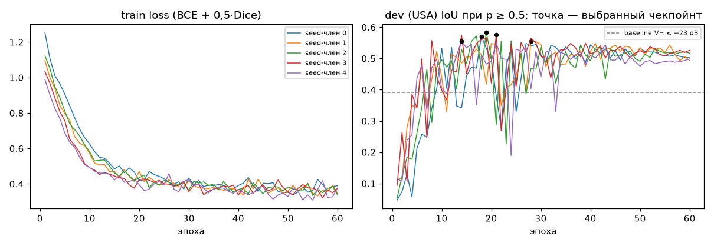
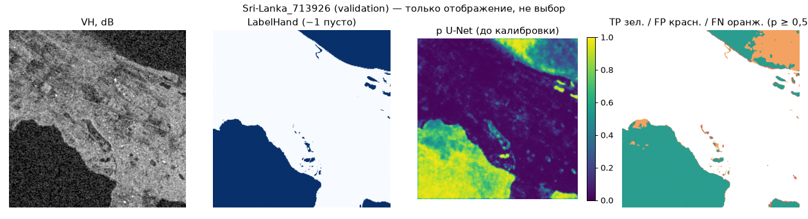

# Основной метод B: компактный U-Net по S1. Проверка на dev и validation

Протокол D-012/D-016. Модель, вариант и чекпойнт выбирались **только на dev** (USA, 69 чипов).
**Validation** (Sri-Lanka и Nigeria, 60 чипов) приведена только для справки: калибровку и
итоговый порог на ней выбирает #20. **Test не читался**: метки test запечатаны
`floodvalue.data.io.load_label`, а код обучения запрашивает только части
train/dev/validation. Split — `splits/split_v1.json`, sha256 `0098346e…` (D-016).

Все числа ниже — пулированный IoU (TP / (TP + FP + FN) по всем валидным пикселям части) при
p ≥ 0,5, до калибровки. Валидный пиксель: S1 конечен в обоих каналах **и** метка ∈ {0, 1}.
`valid_mask_sha256` в `unet-metrics.csv` совпадает с `baseline-metrics.csv` по каждой
строке dev/validation, значит оба метода считаются на одних и тех же пикселях. Это проверяет
тест `tests/model/test_unet.py::test_shipped_unet_metrics_use_same_valid_pixels_as_baseline`.

## Метод

- **Вход — только S1**: VV, VH, VV−VH (разность в dB, то есть логарифм отношения) и канал
  валидности. Перед нормализацией значения клиппируются: VV [−40; 10], VH [−45; 0],
  VV−VH [−5; 25] dB. Среднее и std считаются по валидным пикселям train, записаны в
  `models/unet/config.json`. NaN дают 0 после нормализации и 0 в канале валидности; «ярким
  сухим» пикселем они не становятся.
- **Сеть** (`src/floodvalue/model/unet/net.py`): энкодер из блоков [Conv3×3-BN-ReLU]×2 с
  каналами 16→32→64→128→256 и MaxPool между ними, декодер ConvTranspose2×2 + skip-concat +
  тот же блок, на выходе 1×1-свёртка → логит. U-Net с 4 уровнями, базовая ширина 16, BatchNorm, Dropout2d 0,1 в bottleneck,
  1,94 млн параметров, 7,4 МБ на член ансамбля. Предобученных весов и скачиваний нет.
- **Обучение**: потери = маскированная BCE + 0,5·soft Dice. Пиксели с меткой −1 и с NaN в S1
  исключены. Dice учитывает дисбаланс: воды около 8 % в train. Аугментации: случайный кроп
  256 из 512, rot90, горизонтальный флип и общий сдвиг VV и VH на U(−1; 1) dB (имитирует
  разницу абсолютной калибровки между сценами). Оптимизатор AdamW, lr 1e-3, OneCycle,
  60 эпох по 29 шагов, батч 16, bf16 autocast на GPU. Фиксированный seed, cudnn deterministic.
- **Чекпойнт**: эпоха с максимальным IoU на dev при p ≥ 0,5.
- **Inference**: сеть полностью свёрточная. Обучение идёт на кропах 256, применение — на
  целом чипе 512×512; размер, не кратный 16, дополняется нулями как невалидные пиксели.
  Вероятность = sigmoid(логит) каждого члена, p = среднее по 5 членам. NaN в S1 дают NaN в p.
  Маска `flood_mask.tif` = p ≥ `threshold` из `config.json`: пока 0,5, заменит #20.
- **Только S1**: код читает лишь `S1Hand` (`floodvalue.data.io.load_s1`). Каналы S2, DEM и
  JRC нигде не подаются; метки нужны только для потерь и метрик.
- **Итоговая модель**: ансамбль из 5 seed (20260925, 1, 2, 3, 4) одной конфигурации;
  p — среднее вероятностей членов. Состав `members` и sha256 каждого файла — в `config.json`.
- **Inference на CPU**: 0,46 с на чип 512×512 для всего ансамбля из 5 членов (вывод
  `predict` ниже).

## Baseline → U-Net (одни и те же валидные пиксели)

| Часть | Событие | Пикселей | Baseline VH ≤ −23 dB, IoU | U-Net-ансамбль, IoU | 95 % CI U-Net (бутстрэп по чипам) | U-Net P / R |
|---|---|---|---|---|---|---|
| dev (выбор) | USA | 17 638 830 | 0,391 [0,295; 0,479] | **0,584** | [0,479; 0,681] | 0,745 / 0,731 |
| validation (справочно) | ALL | 13 983 779 | 0,580 [0,445; 0,679] | **0,600** | [0,412; 0,722] | 0,958 / 0,617 |
| validation | Nigeria | 4 020 518 | 0,572 | **0,691** | — | 0,953 / 0,716 |
| validation | Sri-Lanka | 9 963 261 | **0,585** | 0,526 | — | 0,963 / 0,537 |

Источники: `docs/verification/baseline-metrics.csv` (#5) и `docs/verification/unet-metrics.csv`
(= `models/unet/metrics.csv`). CI — `models/unet/summary.json`.

**Парный бутстрэп по чипам** (2000 повторов, U-Net и baseline на одних выборках чипов):
разность IoU U-Net − baseline на dev составляет +0,194, 95 % CI [+0,141; +0,250]. На
validation — +0,020, CI [−0,070; +0,078]: при сыром пороге разница с baseline на validation
**статистически не значима**. Baseline, пересчитанный этим же скриптом (VH ≤ −23 dB),
совпал с `baseline-metrics.csv`: dev 0,3908, validation 0,5800. Порог baseline подобран на
train, канал выбран на dev (`models/baseline/config.json`), validation для этого не
использовалась.

**Оптимизм dev.** Dev используется трижды: для выбора эпохи, для выбора варианта и для
отчёта. Поэтому 0,584 — завышенная оценка. Для сравнения: IoU членов ансамбля на
**последней** эпохе (60-я, без выбора эпохи) — 0,503 / 0,494 / 0,517 / 0,526 / 0,499,
в среднем 0,508 против 0,568 на выбранных эпохах. Независимая оценка переноса — test
(#19, `eval-test`).

Что видно по таблице:

- На dev U-Net заметно лучше baseline: 0,584 против 0,391, доверительные интервалы не
  пересекаются.
- На validation при сыром пороге 0,5 точность очень высокая (0,96), полнота низкая (0,62).
  Сеть недооценивает воду: в train её около 8 %, в validation — 15 %. Именно это смещение
  исправляет калибровка и выбор порога на validation в #20. Диагностика: наибольший IoU по
  сетке порогов на validation — 0,685 при p ≥ 0,20. Порог здесь **не выбирался**, число
  приведено только как ориентир для #20.
- **Sri-Lanka — слабое место.** При p ≥ 0,5 U-Net хуже baseline (0,526 против 0,585), и
  разброс по seed большой: IoU одиночных моделей на Sri-Lanka от 0,11 до 0,59, см.
  `unet-variants.csv`. Ансамбль гасит выбросы: худший член (seed 4, Sri-Lanka 0,115) не
  утягивает ансамбль вниз. Но перенос на это событие остаётся нестабильным. Это
  ограничение метода, о нём нужно говорить честно.

## Контролируемый эксперимент (материал для #18, критерий 8): выбор только по dev

У каждого варианта 3 seed (20260925, 1, 2), остальное одинаково.
Построчно — `docs/verification/unet-variants.csv`.

| Вариант | seed | dev IoU@0,5 (среднее ± sd) | dev IoU при лучшем пороге (диагн.) | validation IoU@0,5 (справочно) | Nigeria | Sri-Lanka | эпохи чекпойнтов |
|---|---|---|---|---|---|---|---|
| **база** (VV, VH, VV−VH; ширина 16; BCE+Dice; ±1 dB) | 3 | **0,570 ± 0,014** | 0,574 ± 0,012 | 0,599 ± 0,058 | 0,687 ± 0,014 | 0,528 ± 0,107 | 18, 28, 19 |
| без VV−VH (VV, VH) | 3 | 0,566 ± 0,017 | 0,566 ± 0,017 | 0,571 ± 0,026 | 0,688 ± 0,024 | 0,476 ± 0,066 | 32, 15, 19 |
| без сдвига на dB | 3 | **0,570 ± 0,003** | 0,574 ± 0,003 | 0,607 ± 0,049 | 0,656 ± 0,033 | 0,568 ± 0,063 | 16, 13, 18 |
| только BCE (без Dice) | 3 | 0,557 ± 0,008 | 0,557 ± 0,007 | 0,518 ± 0,093 | 0,682 ± 0,012 | 0,384 ± 0,159 | 35, 30, 36 |
| ширина 32 (7,8 млн параметров) | 3 | 0,550 ± 0,002 | 0,552 ± 0,004 | 0,610 ± 0,042 | 0,693 ± 0,059 | 0,543 ± 0,080 | 41, 25, 10 |
| **ансамбль 5 seed базы** | 5 | **0,584** | 0,584 | 0,600 | 0,691 | 0,526 | — |
| одиночная модель базы, 5 seed | 5 | 0,568 ± 0,013 | — | 0,559 ± 0,109 | 0,692 ± 0,012 | 0,450 ± 0,203 | 18, 28, 19, 21, 14 |

Выводы (только по dev):

1. **Dice.** Без него dev IoU ниже на 0,013 (около 1 sd, на границе шума). Вариант «только
   BCE» сильнее занижает p: на validation полнота 0,46–0,64 при точности 0,96. Это
   наблюдение на validation, в выборе оно не участвовало.
2. **Ширина 32 не помогает**: dev 0,550 против 0,570, при этом в 4 раза больше параметров и
   в 1,7 раза дольше обучение. Для переноса на новое событие компактная сеть лучше.
3. **VV−VH даёт немного** (+0,004, в пределах разброса по seed). Канал оставлен: его
   вычисление ничего не стоит, и на dev он не хуже.
4. **Сдвиг на dB на dev нейтрален** (0,570 против 0,570). Остаётся в базе как заранее
   заданная настройка. Правило выбора: вариант заменяет базу, только если выигрывает на dev
   больше одного sd. На dev с одним событием различить эти два варианта нельзя.
5. **Ансамбль из 5 seed** — лучший результат на dev (0,584 против 0,568 ± 0,013 у одиночной
   модели). Главное: он убирает зависимость результата от seed, которая на новом событии
   доходит до ±0,2 IoU (Sri-Lanka). Цена — 5 × 7,4 МБ весов и 0,46 с на CPU.

Ограничение протокола: dev — одно событие USA с 4,6 % воды. Различия между вариантами
(< 0,02) лежат внутри разброса по seed и бутстрэп-интервала dev (±0,1). Поэтому для VV−VH,
сдвига на dB, а в строгом смысле и для Dice вывод звучит как «влияние на dev не
обнаружено», а не «вклад компонента». Уверенно отвергнута только ширина 32: sd мал, разница
0,020 — это больше 5 sd.

## Кривые обучения



`models/unet/history_member_<i>.csv` — train loss, dev BCE, dev IoU/P/R, lr и время по
эпохам для каждого члена ансамбля. На dev IoU выходит на плато к 15–30-й эпохе, дальше
колеблется ±0,03. Для каждого члена берётся эпоха с лучшим результатом на dev.



`Sri-Lanka_713926` (validation, только иллюстрация). При p ≥ 0,5 основная ошибка — FN
(оранжевое) на краях крупного водоёма. Это то же занижение p на событии с большей долей
воды, которое исправляет #20.

## Воспроизведение

```bash
# обучение (GPU; на CPU работает, но медленно): 5 seed → ансамбль в models/unet/
FLOODVALUE_DATA_DIR=… uv run --frozen python -m floodvalue train
# один вариант эксперимента
python -m floodvalue.model.unet.train --name unet_vvvh --channels vv,vh --seed 1 --out-dir <dir>
python -m floodvalue.model.unet.ensemble --members <dir1>,<dir2>,… --out-dir models/unet
# inference на CPU по lock-файлу
uv run --frozen python -m floodvalue predict --chip Sri-Lanka_713926 --out <tmp>
```

Обучение шло на RTX 4080 (torch 2.11+cu128, вне lock-файла), около 75 с на один член.
Обучение на GPU побитово не воспроизводится; допуск — ±0,02 IoU на dev (разброс по seed —
в таблице). Inference сохранённых весов на CPU детерминирован. Проверка sha256 весов при
загрузке ловит LFS-указатель, если объекты не скачаны.

Вывод `uv run --frozen python -m floodvalue predict --chip Sri-Lanka_713926 --out …` (CPU):
`{"method": "unet", "weights_sha256": "504944cd…", "threshold": 0.5, "valid_pixels": 262144, "seconds": 0.46}`.
